# Phishing IA — expliqué simplement

## 1. C’est quoi ?
Le **phishing** (hameçonnage), c’est une **arnaque par message** (email, SMS, WhatsApp, etc.).  
L’attaquant se fait passer pour quelqu’un de confiance : banque, collègue, support IT, service de livraison, administration…

## 2. Quel est l’objectif de l’attaquant ?
L’objectif est de te faire faire une action qui lui profite, par exemple :
- **Voler tes identifiants** : mot de passe, code, compte.
- **Voler de l’argent** : faux paiement, faux virement.
- **Installer un malware** : via un lien ou une pièce jointe.
- **Entrer dans l’entreprise** : récupérer un accès pour aller plus loin.

## 3. Comment fonctionne la logique (étape par étape)
1. **Appât** : l’attaquant envoie un message crédible. Ex. : « Votre compte sera bloqué », « Facture urgente ».
2. **Pression** : il crée l’urgence ou la peur pour que tu agisses vite sans vérifier.
3. **Piège** : le message contient un lien, une pièce jointe, ou demande une information sensible.
4. **Action de la victime** : tu cliques, ouvres, réponds, ou donnes tes informations.
5. **Résultat** : l’attaquant récupère ce qu’il voulait (accès, argent, données).

## 4. Exemple concret
> « Votre compte sera désactivé dans 1 heure. Cliquez ici pour vérifier. »

- Tu cliques sur le lien.
- Tu arrives sur un faux site qui ressemble au vrai.
- Tu entres ton mot de passe.
- L’attaquant récupère ton mot de passe.

## 5. Pourquoi l’IA rend le phishing plus difficile à repérer
Avant : fautes, texte bizarre, message générique.  
Avec l’IA, un message peut être bien écrit, personnalisé, adapté au ton d’un collègue/service, donc plus crédible. Les anciens signes seuls ne suffisent plus.

## 6. Lien avec le projet (logique du modèle)
Le modèle ne « lit » pas comme un humain. Il regarde des **signaux/variables** et combine ces signaux pour estimer une probabilité : **malveillant (Oui)** ou **normal (Non)**.  
C’est une **aide à la décision** : un humain doit vérifier avant de bloquer/supprimer.


## 0. Origine et nature des données

**Jeu de données synthétique** généré localement pour ce mini-projet (ISCAE Master VIC). Il ne contient **aucun vrai e-mail, aucune donnée personnelle et aucune source externe** à citer. Les performances mesurées ici ne doivent donc **pas** être présentées comme des résultats obtenus sur de vraies campagnes de phishing.

**Avertissement** : prototype d'aide au pré-dépistage. Le modèle signale un message à **vérifier** ; il ne supprime rien automatiquement. **Validation humaine obligatoire.**

## Notre objectif : pré-dépistage

Dans ce projet, le modèle fait du **pré-dépistage** : il trie rapidement les messages pour repérer ceux qui sont suspects.

- **Entrée** : les signaux du message (urgence, liens, âge du domaine, expéditeur connu, etc.).
- **Sortie** : `Oui` (suspect/malveillant) ou `Non` (normal), avec une probabilité.
- **Exemple** : `urgence_score=9`, `nb_liens=5`, `domaine_age_jours=3`, `expediteur_connu=0`, `piece_jointe=1` → le modèle peut prédire **Oui**.

Le résultat est une **aide à la décision**. La vérification finale reste humaine.


## Comment choisir un modèle ?

### 1. Le contexte
On veut détecter les messages **malveillants (phishing IA)**. Les classes sont déséquilibrées (377 Non / 147 Oui). L’erreur la plus grave est le **Faux Négatif** : un message malveillant prédit `Non`.

### 2. Sur quelle base on choisit ?
- **F1 macro** : critère principal ici, car il donne du poids aux deux classes malgré le déséquilibre.
- **Rappel de la classe Oui** : très important en sécurité, car il mesure combien de malveillants on détecte.
- **Précision / FP** : à surveiller pour éviter trop de fausses alertes.
- **Matrice de confusion** : montre FN/FP en nombres concrets.
- **Simplicité/interprétabilité** : utile pour expliquer la décision à un humain.

### 3. Modèles comparés
| Modèle | Intérêt | Limite |
|---|---|---|
| Régression logistique | Simple, interprétable | Peut rater des relations non linéaires |
| Random Forest | Bon sur relations non linéaires, robuste | Moins simple à expliquer |
| SVM noyau RBF | Marge maximale, très stable en validation croisée | Moins interprétable, plus lent |

### 4. Notre choix
On compare les modèles sur le **même test**. On retient le modèle avec le meilleur compromis, en priorité **F1 macro / Rappel Oui** (moins de FN), tout en gardant une validation humaine. Le modèle retenu dans ce projet est indiqué par les résultats et `model_meta.json`.


# Mini-projet 3 — Veille stratégique : IA et confiance numérique
## Notebook dédié — Phishing assisté par l'IA

**ISCAE — Master VIC | Analyse exploratoire, préparation et classification Machine Learning**

Ce notebook travaille **uniquement** sur `dataset_phishing_ia - dataset_phishing_ia.csv`.
Les cas désinformation et Shadow IA ont chacun leur notebook dédié.

### 1) Contexte général
L'IA générative écrit des messages de phishing sans fautes et avec un ton personnalisé. Les signes
classiques (fautes de langue, style maladroit) deviennent donc moins fiables. Un responsable
sécurité (RSSI) doit pourtant décider, parmi les messages reçus, lesquels méritent une analyse
approfondie. Les 524 lignes du fichier sont **synthétiques** : aucune donnée personnelle, aucun
vrai e-mail.

### 2) Problématique
> **Comment détecter un message malveillant quand les signes classiques deviennent moins fiables
> à cause de l'IA, et comment garder un niveau d'alerte explicable ?**

La cible `message_malveillant` est binaire (`Non` / `Oui`), avec 377 `Non` pour 147 `Oui` :
les classes sont **déséquilibrées**. L'accuracy seule est trompeuse (prédire toujours `Non`
donne déjà ~72 %) : on regarde surtout le **rappel** et le **F1** de la classe `Oui`.

### 3) Quelle erreur coûte le plus cher ?
Le **faux négatif** : un message malveillant classé `Non` passe les filtres et peut déclencher
une compromission. Le faux positif (message légitime signalé) coûte du temps à l'analyste mais
se corrige par validation humaine. On peut donc **baisser le seuil de décision** pour gagner en
rappel, en acceptant plus de faux positifs — ce compromis est étudié plus bas.

Exécuter les cellules dans l'ordre, de haut en bas.

## 0. Installation et importation des bibliothèques
Installer une seule fois les bibliothèques si nécessaire.


```python
# Dans un terminal Jupyter si les bibliothèques ne sont pas installées :
# %pip install pandas numpy matplotlib seaborn scikit-learn joblib

import warnings
warnings.filterwarnings("ignore")

import numpy as np
import pandas as pd
import matplotlib.pyplot as plt
import seaborn as sns

from pathlib import Path
from IPython.display import display

from sklearn.model_selection import train_test_split, cross_validate, StratifiedKFold
from sklearn.compose import ColumnTransformer
from sklearn.pipeline import Pipeline
from sklearn.preprocessing import OneHotEncoder, StandardScaler
from sklearn.impute import SimpleImputer
from sklearn.svm import SVC
from sklearn.linear_model import LogisticRegression
from sklearn.ensemble import RandomForestClassifier
from sklearn.metrics import (
    accuracy_score, precision_score, recall_score, f1_score,
    classification_report, confusion_matrix, ConfusionMatrixDisplay
)
from sklearn.inspection import permutation_importance
from sklearn.base import clone
import joblib

RANDOM_STATE = 42
pd.set_option("display.max_columns", None)
sns.set_theme(style="whitegrid")
print("Bibliothèques chargées avec succès.")
```

    Bibliothèques chargées avec succès.


## 1. Lecture du fichier — dataset unique : Phishing IA

Le CSV doit être dans le même dossier que ce notebook. Les constantes ci-dessous pointent
directement sur le seul fichier utilisé ; il n'y a plus de choix à faire.

## 1. Lecture du fichier

Le notebook utilise directement le dataset phishing IA présent dans le même dossier.


```python
# Chargement du dataset
import pandas as pd

df_brut = pd.read_csv('dataset_phishing_ia - dataset_phishing_ia.csv')
TARGET = 'message_malveillant'
ORDER = ['Non', 'Oui']

print('Dimensions (lignes, colonnes) :', df_brut.shape)

```

    Dimensions (lignes, colonnes) : (524, 11)


```python
# Dernières lignes
df_brut.tail()

```


<div>
<style scoped>
    .dataframe tbody tr th:only-of-type {
        vertical-align: middle;
    }

    .dataframe tbody tr th {
        vertical-align: top;
    }

    .dataframe thead th {
        text-align: right;
    }
</style>
<table border="1" class="dataframe">
  <thead>
    <tr style="text-align: right;">
      <th></th>
      <th>date</th>
      <th>heure_envoi</th>
      <th>longueur_message</th>
      <th>nb_liens</th>
      <th>urgence_score</th>
      <th>domaine_age_jours</th>
      <th>fautes_langue</th>
      <th>expediteur_connu</th>
      <th>piece_jointe</th>
      <th>personnalisation_score</th>
      <th>message_malveillant</th>
    </tr>
  </thead>
  <tbody>
    <tr>
      <th>519</th>
      <td>2026-09-29</td>
      <td>5</td>
      <td>222</td>
      <td>1</td>
      <td>4</td>
      <td>5874.0</td>
      <td>1</td>
      <td>0</td>
      <td>0</td>
      <td>6</td>
      <td>Non</td>
    </tr>
    <tr>
      <th>520</th>
      <td>2026-09-30</td>
      <td>10</td>
      <td>475</td>
      <td>4</td>
      <td>10</td>
      <td>41.0</td>
      <td>4</td>
      <td>0</td>
      <td>0</td>
      <td>7</td>
      <td>Oui</td>
    </tr>
    <tr>
      <th>521</th>
      <td>2026-09-30</td>
      <td>6</td>
      <td>107</td>
      <td>0</td>
      <td>10</td>
      <td>661.0</td>
      <td>2</td>
      <td>1</td>
      <td>1</td>
      <td>6</td>
      <td>Non</td>
    </tr>
    <tr>
      <th>522</th>
      <td>2026-09-30</td>
      <td>14</td>
      <td>509</td>
      <td>0</td>
      <td>4</td>
      <td>1227.0</td>
      <td>2</td>
      <td>1</td>
      <td>0</td>
      <td>5</td>
      <td>Non</td>
    </tr>
    <tr>
      <th>523</th>
      <td>2026-09-30</td>
      <td>21</td>
      <td>507</td>
      <td>1</td>
      <td>4</td>
      <td>800.0</td>
      <td>3</td>
      <td>0</td>
      <td>1</td>
      <td>5</td>
      <td>Non</td>
    </tr>
  </tbody>
</table>
</div>


```python
# Colonnes
df_brut.columns.tolist()

```


    ['date',
     'heure_envoi',
     'longueur_message',
     'nb_liens',
     'urgence_score',
     'domaine_age_jours',
     'fautes_langue',
     'expediteur_connu',
     'piece_jointe',
     'personnalisation_score',
     'message_malveillant']


```python
# Informations générales
df_brut.info()

```

    <class 'pandas.DataFrame'>
    RangeIndex: 524 entries, 0 to 523
    Data columns (total 11 columns):
     #   Column                  Non-Null Count  Dtype  
    ---  ------                  --------------  -----  
     0   date                    524 non-null    str    
     1   heure_envoi             524 non-null    int64  
     2   longueur_message        524 non-null    int64  
     3   nb_liens                524 non-null    int64  
     4   urgence_score           524 non-null    int64  
     5   domaine_age_jours       514 non-null    float64
     6   fautes_langue           524 non-null    int64  
     7   expediteur_connu        524 non-null    int64  
     8   piece_jointe            524 non-null    int64  
     9   personnalisation_score  524 non-null    int64  
     10  message_malveillant     524 non-null    str    
    dtypes: float64(1), int64(8), str(2)
    memory usage: 45.2 KB


```python
# Dictionnaire des variables (signification métier)
SIGNIFICATIONS = {
    "date": "Date de réception — exclue du modèle (variable calendaire sans rôle métier).",
    "heure_envoi": "Heure d'envoi (0-23) : un envoi nocturne est plus suspect.",
    "longueur_message": "Nombre de caractères du message.",
    "nb_liens": "Nombre de liens intégrés : chaque lien augmente le risque.",
    "urgence_score": "Score 0-10 de pression temporelle (« agissez maintenant »).",
    "domaine_age_jours": "Ancienneté du domaine en jours (10 valeurs manquantes) : un domaine récent est suspect.",
    "fautes_langue": "Nombre de fautes de langue — signe classique, mais moins fiable avec l'IA.",
    "expediteur_connu": "1 = expéditeur déjà connu, 0 = inconnu.",
    "piece_jointe": "1 = pièce jointe présente, 0 = absente.",
    "personnalisation_score": "Score 0-10 de personnalisation du message (l'IA sait mieux imiter un collègue).",
    "message_malveillant": "CIBLE : Non / Oui. Jamais utilisée comme variable explicative.",
}
dictionnaire = pd.DataFrame({
    "variable": df_brut.columns,
    "type": [str(df_brut[c].dtype) for c in df_brut.columns],
    "valeurs_manquantes": [df_brut[c].isna().sum() for c in df_brut.columns],
    "valeurs_uniques": [df_brut[c].nunique(dropna=True) for c in df_brut.columns],
    "exemples": [str(df_brut[c].dropna().unique()[:5].tolist()) for c in df_brut.columns],
    "signification_metier": [SIGNIFICATIONS.get(col, "À préciser") for col in df_brut.columns],
})
dictionnaire

```


<div>
<style scoped>
    .dataframe tbody tr th:only-of-type {
        vertical-align: middle;
    }

    .dataframe tbody tr th {
        vertical-align: top;
    }

    .dataframe thead th {
        text-align: right;
    }
</style>
<table border="1" class="dataframe">
  <thead>
    <tr style="text-align: right;">
      <th></th>
      <th>variable</th>
      <th>type</th>
      <th>valeurs_manquantes</th>
      <th>valeurs_uniques</th>
      <th>exemples</th>
      <th>signification_metier</th>
    </tr>
  </thead>
  <tbody>
    <tr>
      <th>0</th>
      <td>date</td>
      <td>str</td>
      <td>0</td>
      <td>231</td>
      <td>['2026-01-01', '2026-01-03', '2026-01-04', '20...</td>
      <td>Date de réception — exclue du modèle (variable...</td>
    </tr>
    <tr>
      <th>1</th>
      <td>heure_envoi</td>
      <td>int64</td>
      <td>0</td>
      <td>24</td>
      <td>[19, 22, 12, 13, 18]</td>
      <td>Heure d'envoi (0-23) : un envoi nocturne est p...</td>
    </tr>
    <tr>
      <th>2</th>
      <td>longueur_message</td>
      <td>int64</td>
      <td>0</td>
      <td>330</td>
      <td>[709, 303, 246, 355, 235]</td>
      <td>Nombre de caractères du message.</td>
    </tr>
    <tr>
      <th>3</th>
      <td>nb_liens</td>
      <td>int64</td>
      <td>0</td>
      <td>6</td>
      <td>[0, 2, 4, 1, 3]</td>
      <td>Nombre de liens intégrés : chaque lien augment...</td>
    </tr>
    <tr>
      <th>4</th>
      <td>urgence_score</td>
      <td>int64</td>
      <td>0</td>
      <td>11</td>
      <td>[4, 6, 7, 5, 3]</td>
      <td>Score 0-10 de pression temporelle (« agissez m...</td>
    </tr>
    <tr>
      <th>5</th>
      <td>domaine_age_jours</td>
      <td>float64</td>
      <td>10</td>
      <td>425</td>
      <td>[1133.0, 268.0, 138.0, 790.0, 323.0]</td>
      <td>Ancienneté du domaine en jours (10 valeurs man...</td>
    </tr>
    <tr>
      <th>6</th>
      <td>fautes_langue</td>
      <td>int64</td>
      <td>0</td>
      <td>7</td>
      <td>[3, 2, 4, 0, 1]</td>
      <td>Nombre de fautes de langue — signe classique, ...</td>
    </tr>
    <tr>
      <th>7</th>
      <td>expediteur_connu</td>
      <td>int64</td>
      <td>0</td>
      <td>2</td>
      <td>[0, 1]</td>
      <td>1 = expéditeur déjà connu, 0 = inconnu.</td>
    </tr>
    <tr>
      <th>8</th>
      <td>piece_jointe</td>
      <td>int64</td>
      <td>0</td>
      <td>2</td>
      <td>[0, 1]</td>
      <td>1 = pièce jointe présente, 0 = absente.</td>
    </tr>
    <tr>
      <th>9</th>
      <td>personnalisation_score</td>
      <td>int64</td>
      <td>0</td>
      <td>11</td>
      <td>[8, 6, 4, 3, 0]</td>
      <td>Score 0-10 de personnalisation du message (l'I...</td>
    </tr>
    <tr>
      <th>10</th>
      <td>message_malveillant</td>
      <td>str</td>
      <td>0</td>
      <td>2</td>
      <td>['Non', 'Oui']</td>
      <td>CIBLE : Non / Oui. Jamais utilisée comme varia...</td>
    </tr>
  </tbody>
</table>
</div>


```python
print("Statistiques descriptives des variables numériques :")
display(df_brut.describe().T)

print("Statistiques descriptives de toutes les variables :")
display(df_brut.describe(include="all").T)
```

    Statistiques descriptives des variables numériques :


<div>
<style scoped>
    .dataframe tbody tr th:only-of-type {
        vertical-align: middle;
    }

    .dataframe tbody tr th {
        vertical-align: top;
    }

    .dataframe thead th {
        text-align: right;
    }
</style>
<table border="1" class="dataframe">
  <thead>
    <tr style="text-align: right;">
      <th></th>
      <th>count</th>
      <th>mean</th>
      <th>std</th>
      <th>min</th>
      <th>25%</th>
      <th>50%</th>
      <th>75%</th>
      <th>max</th>
    </tr>
  </thead>
  <tbody>
    <tr>
      <th>heure_envoi</th>
      <td>524.0</td>
      <td>12.238550</td>
      <td>6.889344</td>
      <td>0.0</td>
      <td>6.00</td>
      <td>13.0</td>
      <td>18.00</td>
      <td>23.0</td>
    </tr>
    <tr>
      <th>longueur_message</th>
      <td>524.0</td>
      <td>413.225191</td>
      <td>162.774765</td>
      <td>60.0</td>
      <td>301.50</td>
      <td>423.0</td>
      <td>523.25</td>
      <td>896.0</td>
    </tr>
    <tr>
      <th>nb_liens</th>
      <td>524.0</td>
      <td>1.387405</td>
      <td>1.165433</td>
      <td>0.0</td>
      <td>1.00</td>
      <td>1.0</td>
      <td>2.00</td>
      <td>5.0</td>
    </tr>
    <tr>
      <th>urgence_score</th>
      <td>524.0</td>
      <td>4.519084</td>
      <td>2.373696</td>
      <td>0.0</td>
      <td>3.00</td>
      <td>4.0</td>
      <td>6.00</td>
      <td>10.0</td>
    </tr>
    <tr>
      <th>domaine_age_jours</th>
      <td>514.0</td>
      <td>739.330739</td>
      <td>761.682914</td>
      <td>1.0</td>
      <td>217.25</td>
      <td>516.0</td>
      <td>951.25</td>
      <td>5874.0</td>
    </tr>
    <tr>
      <th>fautes_langue</th>
      <td>524.0</td>
      <td>2.020992</td>
      <td>1.387440</td>
      <td>0.0</td>
      <td>1.00</td>
      <td>2.0</td>
      <td>3.00</td>
      <td>6.0</td>
    </tr>
    <tr>
      <th>expediteur_connu</th>
      <td>524.0</td>
      <td>0.440840</td>
      <td>0.496962</td>
      <td>0.0</td>
      <td>0.00</td>
      <td>0.0</td>
      <td>1.00</td>
      <td>1.0</td>
    </tr>
    <tr>
      <th>piece_jointe</th>
      <td>524.0</td>
      <td>0.232824</td>
      <td>0.423035</td>
      <td>0.0</td>
      <td>0.00</td>
      <td>0.0</td>
      <td>0.00</td>
      <td>1.0</td>
    </tr>
    <tr>
      <th>personnalisation_score</th>
      <td>524.0</td>
      <td>4.977099</td>
      <td>2.554090</td>
      <td>0.0</td>
      <td>3.00</td>
      <td>5.0</td>
      <td>7.00</td>
      <td>10.0</td>
    </tr>
  </tbody>
</table>
</div>


    Statistiques descriptives de toutes les variables :


<div>
<style scoped>
    .dataframe tbody tr th:only-of-type {
        vertical-align: middle;
    }

    .dataframe tbody tr th {
        vertical-align: top;
    }

    .dataframe thead th {
        text-align: right;
    }
</style>
<table border="1" class="dataframe">
  <thead>
    <tr style="text-align: right;">
      <th></th>
      <th>count</th>
      <th>unique</th>
      <th>top</th>
      <th>freq</th>
      <th>mean</th>
      <th>std</th>
      <th>min</th>
      <th>25%</th>
      <th>50%</th>
      <th>75%</th>
      <th>max</th>
    </tr>
  </thead>
  <tbody>
    <tr>
      <th>date</th>
      <td>524</td>
      <td>231</td>
      <td>2026-02-22</td>
      <td>7</td>
      <td>NaN</td>
      <td>NaN</td>
      <td>NaN</td>
      <td>NaN</td>
      <td>NaN</td>
      <td>NaN</td>
      <td>NaN</td>
    </tr>
    <tr>
      <th>heure_envoi</th>
      <td>524.0</td>
      <td>NaN</td>
      <td>NaN</td>
      <td>NaN</td>
      <td>12.23855</td>
      <td>6.889344</td>
      <td>0.0</td>
      <td>6.0</td>
      <td>13.0</td>
      <td>18.0</td>
      <td>23.0</td>
    </tr>
    <tr>
      <th>longueur_message</th>
      <td>524.0</td>
      <td>NaN</td>
      <td>NaN</td>
      <td>NaN</td>
      <td>413.225191</td>
      <td>162.774765</td>
      <td>60.0</td>
      <td>301.5</td>
      <td>423.0</td>
      <td>523.25</td>
      <td>896.0</td>
    </tr>
    <tr>
      <th>nb_liens</th>
      <td>524.0</td>
      <td>NaN</td>
      <td>NaN</td>
      <td>NaN</td>
      <td>1.387405</td>
      <td>1.165433</td>
      <td>0.0</td>
      <td>1.0</td>
      <td>1.0</td>
      <td>2.0</td>
      <td>5.0</td>
    </tr>
    <tr>
      <th>urgence_score</th>
      <td>524.0</td>
      <td>NaN</td>
      <td>NaN</td>
      <td>NaN</td>
      <td>4.519084</td>
      <td>2.373696</td>
      <td>0.0</td>
      <td>3.0</td>
      <td>4.0</td>
      <td>6.0</td>
      <td>10.0</td>
    </tr>
    <tr>
      <th>domaine_age_jours</th>
      <td>514.0</td>
      <td>NaN</td>
      <td>NaN</td>
      <td>NaN</td>
      <td>739.330739</td>
      <td>761.682914</td>
      <td>1.0</td>
      <td>217.25</td>
      <td>516.0</td>
      <td>951.25</td>
      <td>5874.0</td>
    </tr>
    <tr>
      <th>fautes_langue</th>
      <td>524.0</td>
      <td>NaN</td>
      <td>NaN</td>
      <td>NaN</td>
      <td>2.020992</td>
      <td>1.38744</td>
      <td>0.0</td>
      <td>1.0</td>
      <td>2.0</td>
      <td>3.0</td>
      <td>6.0</td>
    </tr>
    <tr>
      <th>expediteur_connu</th>
      <td>524.0</td>
      <td>NaN</td>
      <td>NaN</td>
      <td>NaN</td>
      <td>0.44084</td>
      <td>0.496962</td>
      <td>0.0</td>
      <td>0.0</td>
      <td>0.0</td>
      <td>1.0</td>
      <td>1.0</td>
    </tr>
    <tr>
      <th>piece_jointe</th>
      <td>524.0</td>
      <td>NaN</td>
      <td>NaN</td>
      <td>NaN</td>
      <td>0.232824</td>
      <td>0.423035</td>
      <td>0.0</td>
      <td>0.0</td>
      <td>0.0</td>
      <td>0.0</td>
      <td>1.0</td>
    </tr>
    <tr>
      <th>personnalisation_score</th>
      <td>524.0</td>
      <td>NaN</td>
      <td>NaN</td>
      <td>NaN</td>
      <td>4.977099</td>
      <td>2.55409</td>
      <td>0.0</td>
      <td>3.0</td>
      <td>5.0</td>
      <td>7.0</td>
      <td>10.0</td>
    </tr>
    <tr>
      <th>message_malveillant</th>
      <td>524</td>
      <td>2</td>
      <td>Non</td>
      <td>377</td>
      <td>NaN</td>
      <td>NaN</td>
      <td>NaN</td>
      <td>NaN</td>
      <td>NaN</td>
      <td>NaN</td>
      <td>NaN</td>
    </tr>
  </tbody>
</table>
</div>


```python
print("Nombre de valeurs distinctes par colonne :")
display(df_brut.nunique().sort_values(ascending=False).to_frame("valeurs_uniques"))

print("Valeurs distinctes de la cible :")
print(df_brut[TARGET].value_counts(dropna=False))


```

    Nombre de valeurs distinctes par colonne :


<div>
<style scoped>
    .dataframe tbody tr th:only-of-type {
        vertical-align: middle;
    }

    .dataframe tbody tr th {
        vertical-align: top;
    }

    .dataframe thead th {
        text-align: right;
    }
</style>
<table border="1" class="dataframe">
  <thead>
    <tr style="text-align: right;">
      <th></th>
      <th>valeurs_uniques</th>
    </tr>
  </thead>
  <tbody>
    <tr>
      <th>domaine_age_jours</th>
      <td>425</td>
    </tr>
    <tr>
      <th>longueur_message</th>
      <td>330</td>
    </tr>
    <tr>
      <th>date</th>
      <td>231</td>
    </tr>
    <tr>
      <th>heure_envoi</th>
      <td>24</td>
    </tr>
    <tr>
      <th>urgence_score</th>
      <td>11</td>
    </tr>
    <tr>
      <th>personnalisation_score</th>
      <td>11</td>
    </tr>
    <tr>
      <th>fautes_langue</th>
      <td>7</td>
    </tr>
    <tr>
      <th>nb_liens</th>
      <td>6</td>
    </tr>
    <tr>
      <th>expediteur_connu</th>
      <td>2</td>
    </tr>
    <tr>
      <th>piece_jointe</th>
      <td>2</td>
    </tr>
    <tr>
      <th>message_malveillant</th>
      <td>2</td>
    </tr>
  </tbody>
</table>
</div>


    Valeurs distinctes de la cible :
    message_malveillant
    Non    377
    Oui    147
    Name: count, dtype: int64


## 3. Dictionnaire des variables et compréhension métier

Cette cellule affiche un dictionnaire automatique (nom, type, nombre de valeurs manquantes et exemples). Compléter ensuite la colonne « signification métier » avec les descriptions du cahier des charges.


```python
SIGNIFICATIONS = {
    "date": "Date de réception — exclue du modèle (variable calendaire sans rôle métier).",
    "heure_envoi": "Heure d'envoi (0-23) : un envoi nocturne est plus suspect.",
    "longueur_message": "Nombre de caractères du message.",
    "nb_liens": "Nombre de liens intégrés : chaque lien augmente le risque.",
    "urgence_score": "Score 0-10 de pression temporelle (« agissez maintenant »).",
    "domaine_age_jours": "Ancienneté du domaine en jours (10 valeurs manquantes) : un domaine récent est suspect.",
    "fautes_langue": "Nombre de fautes de langue — signe classique, mais moins fiable avec l'IA.",
    "expediteur_connu": "1 = expéditeur déjà connu, 0 = inconnu.",
    "piece_jointe": "1 = pièce jointe présente, 0 = absente.",
    "personnalisation_score": "Score 0-10 de personnalisation du message (l'IA sait mieux imiter un collègue).",
    "message_malveillant": "CIBLE : Non / Oui. Jamais utilisée comme variable explicative.",
}
dictionnaire = pd.DataFrame({
    "variable": df_brut.columns,
    "type": [str(df_brut[c].dtype) for c in df_brut.columns],
    "valeurs_manquantes": [df_brut[c].isna().sum() for c in df_brut.columns],
    "valeurs_uniques": [df_brut[c].nunique(dropna=True) for c in df_brut.columns],
    "exemples": [str(df_brut[c].dropna().unique()[:5].tolist()) for c in df_brut.columns],
    "signification_metier": [SIGNIFICATIONS.get(col, "À préciser") for col in df_brut.columns],
})
display(dictionnaire)
```


<div>
<style scoped>
    .dataframe tbody tr th:only-of-type {
        vertical-align: middle;
    }

    .dataframe tbody tr th {
        vertical-align: top;
    }

    .dataframe thead th {
        text-align: right;
    }
</style>
<table border="1" class="dataframe">
  <thead>
    <tr style="text-align: right;">
      <th></th>
      <th>variable</th>
      <th>type</th>
      <th>valeurs_manquantes</th>
      <th>valeurs_uniques</th>
      <th>exemples</th>
      <th>signification_metier</th>
    </tr>
  </thead>
  <tbody>
    <tr>
      <th>0</th>
      <td>date</td>
      <td>str</td>
      <td>0</td>
      <td>231</td>
      <td>['2026-01-01', '2026-01-03', '2026-01-04', '20...</td>
      <td>Date de réception — exclue du modèle (variable...</td>
    </tr>
    <tr>
      <th>1</th>
      <td>heure_envoi</td>
      <td>int64</td>
      <td>0</td>
      <td>24</td>
      <td>[19, 22, 12, 13, 18]</td>
      <td>Heure d'envoi (0-23) : un envoi nocturne est p...</td>
    </tr>
    <tr>
      <th>2</th>
      <td>longueur_message</td>
      <td>int64</td>
      <td>0</td>
      <td>330</td>
      <td>[709, 303, 246, 355, 235]</td>
      <td>Nombre de caractères du message.</td>
    </tr>
    <tr>
      <th>3</th>
      <td>nb_liens</td>
      <td>int64</td>
      <td>0</td>
      <td>6</td>
      <td>[0, 2, 4, 1, 3]</td>
      <td>Nombre de liens intégrés : chaque lien augment...</td>
    </tr>
    <tr>
      <th>4</th>
      <td>urgence_score</td>
      <td>int64</td>
      <td>0</td>
      <td>11</td>
      <td>[4, 6, 7, 5, 3]</td>
      <td>Score 0-10 de pression temporelle (« agissez m...</td>
    </tr>
    <tr>
      <th>5</th>
      <td>domaine_age_jours</td>
      <td>float64</td>
      <td>10</td>
      <td>425</td>
      <td>[1133.0, 268.0, 138.0, 790.0, 323.0]</td>
      <td>Ancienneté du domaine en jours (10 valeurs man...</td>
    </tr>
    <tr>
      <th>6</th>
      <td>fautes_langue</td>
      <td>int64</td>
      <td>0</td>
      <td>7</td>
      <td>[3, 2, 4, 0, 1]</td>
      <td>Nombre de fautes de langue — signe classique, ...</td>
    </tr>
    <tr>
      <th>7</th>
      <td>expediteur_connu</td>
      <td>int64</td>
      <td>0</td>
      <td>2</td>
      <td>[0, 1]</td>
      <td>1 = expéditeur déjà connu, 0 = inconnu.</td>
    </tr>
    <tr>
      <th>8</th>
      <td>piece_jointe</td>
      <td>int64</td>
      <td>0</td>
      <td>2</td>
      <td>[0, 1]</td>
      <td>1 = pièce jointe présente, 0 = absente.</td>
    </tr>
    <tr>
      <th>9</th>
      <td>personnalisation_score</td>
      <td>int64</td>
      <td>0</td>
      <td>11</td>
      <td>[8, 6, 4, 3, 0]</td>
      <td>Score 0-10 de personnalisation du message (l'I...</td>
    </tr>
    <tr>
      <th>10</th>
      <td>message_malveillant</td>
      <td>str</td>
      <td>0</td>
      <td>2</td>
      <td>['Non', 'Oui']</td>
      <td>CIBLE : Non / Oui. Jamais utilisée comme varia...</td>
    </tr>
  </tbody>
</table>
</div>


### Zoom sur `personnalisation_score` : le degré d'adaptation au destinataire

Cet attribut mesure **à quel point un message semble adapté personnellement à son destinataire**,
au lieu d'être un message générique envoyé à tout le monde.

**Exemple 1 — message générique (score faible)**

> Cher client, votre compte nécessite une vérification. Cliquez ici.

Aucune information personnelle : le score de personnalisation doit rester bas.

**Exemple 2 — message personnalisé (score plus élevé)**

> Bonjour Faker, votre compte bancaire associé à votre adresse e-mail nécessite une vérification.

Le prénom et une information qui semble concerner le destinataire sont utilisés : le score monte.

**Comment lire le score ?** Dans ce jeu de données, l'échelle réelle va bien de **0 à 10**
(minimum 0, maximum 10, moyenne 4,98, médiane 5). Lecture indicative :

| Score | Interprétation |
|---|---|
| 0–2 | Très peu personnalisé |
| 3–4 | Faiblement personnalisé |
| 5–7 | Moyennement personnalisé |
| 8–10 | Fortement personnalisé |

Ces bornes sont illustratives : l'échelle du fichier est vérifiée dans le code, pas supposée.

**Rapport avec le phishing**

- Messages normaux : score moyen **4,82**.
- Messages malveillants : score moyen **5,40**.
- Corrélation avec la cible : **+0,10** — faible, mais non nulle.

Le *spear phishing* exploite des informations personnelles pour gagner la confiance. Attention
toutefois : **un message très personnalisé n'est pas forcément malveillant** (les banques et les
entreprises personnalisent aussi). La variable est donc **conservée** dans le modèle, mais elle ne
suffit jamais à elle seule : c'est la combinaison avec l'âge du domaine, l'urgence et l'expéditeur
inconnu qui produit le verdict.


### Dictionnaire détaillé des attributs (définition, échelle, exemple, rôle)

Chaque variable est décrite avec **ce qu'elle mesure**, **comment la lire** et **ce que le modèle en fait**.
Les moyennes citées sont celles du jeu nettoyé (520 messages : 374 `Non`, 146 `Oui`).

| Variable | Définition | Lecture phishing | Rôle dans le modèle |
|---|---|---|---|
| `domaine_age_jours` | Ancienneté du domaine expéditeur en jours (1–5 874 ; 10 NA imputés par la médiane) | Un domaine récent est très suspect : les campagnes utilisent des domaines neufs, pas encore listés. Moyenne : 339 j (`Oui`) contre 897 j (`Non`). | **Conservée**, transformée en `log1p` : variable la plus discriminante. |
| `urgence_score` | Pression temporelle de 0 à 10 (« agissez maintenant », « compte suspendu ») | L'urgence empêche la victime de vérifier par un autre canal. Moyenne : 5,54 (`Oui`) contre 4,11 (`Non`). | **Conservée**, avec l'interaction `urgence × inconnu`. |
| `nb_liens` | Nombre de liens dans le message (0–5) | Chaque lien est une redirection potentielle vers un faux portail. Moyenne : 1,86 (`Oui`) contre 1,20 (`Non`). | **Conservée**, avec l'interaction `liens × inconnu`. |
| `expediteur_connu` | 0/1 : 1 = adresse déjà connue, 0 = inconnue | Les messages malveillants viennent plus souvent d'un inconnu (25 % de `1` côté `Oui` contre 51 % côté `Non`). | **Conservée** (interactions avec urgence et liens). |
| `piece_jointe` | 0/1 : présence d'une pièce jointe | Vecteur d'infection classique (macro, exécutable, PDF piégé), mais les messages professionnels légitimes en ont aussi. 30 % (`Oui`) contre 21 % (`Non`). | **Conservée**, importance modérée. |
| `personnalisation_score` | Degré d'adaptation du message au destinataire (0–10) | Le *spear phishing* utilise des informations personnelles. Moyenne : 5,40 (`Oui`) contre 4,82 (`Non`), corrélation faible (r ≈ +0,10). | **Conservée** : un message personnalisé n'est pas forcément malveillant, mais combiné aux autres signaux il aide. |
| `longueur_message` | Nombre de caractères (60–896) | Les messages malveillants sont ici légèrement plus courts (≈ 395 contre ≈ 421) : contre-intuitif, l'IA peut écrire long. | **Retirée** (bruit, importance négative). |
| `heure_envoi` | Heure d'envoi (0–23) | Un envoi à 3 h peut trahir une automatisation, mais beaucoup de messages légitimes arrivent la nuit. | **Retirée** (importance quasi nulle). |
| `fautes_langue` | Nombre de fautes (0–6) | Signe classique du phishing « artisanal », mais l'IA écrit sans faute : 1,95 (`Oui`) contre 2,05 (`Non`), aucune séparation. | **Retirée** (bruit). |
| `date` | Date de réception | Variable calendaire sans justification métier : elle mémoriserait la période de collecte. | **Exclue** du modèle. |
| `message_malveillant` | Cible : `Non` / `Oui` | Classe à prédire (374 `Non`, 146 `Oui`). | **Jamais** utilisée comme variable explicative. |

**Exemple pour `personnalisation_score`**

> Message générique (score faible) : « Cher client, votre compte nécessite une vérification. Cliquez ici. »

> Message personnalisé (score plus élevé) : « Bonjour Faker, votre compte bancaire associé à votre adresse e-mail nécessite une vérification. »

Le premier n'utilise aucune information personnelle ; le second cite un prénom et un contexte qui semblent concerner le destinataire. Le score monte, mais il ne prouve pas la malveillance : les banques personnalisent aussi leurs messages. Ce qui départage, c'est la **combinaison** avec l'âge du domaine, l'urgence et l'expéditeur inconnu.


### Comment le modèle prédit-il ? (logique pas à pas)

1. **X et y** : `y = message_malveillant`. `X` = toutes les autres colonnes **sauf `date` et
   `semaine`** (le cahier des charges interdit d'utiliser le calendrier sans justification).
   Un `assert` vérifie que la cible n'est pas dans `X` : c'est la règle anti-fuite n°1.
2. **Prétraitement** : `ColumnTransformer` + `Pipeline` — imputation des 10 valeurs manquantes de
   `domaine_age_jours` par la **médiane du train**, standardisation des variables numériques,
   imputation par le mode puis one-hot pour les catégorielles. Rien n'est calculé sur le test.
3. **Comparaison** : régression logistique (linéaire), Random Forest (arbres) et SVM noyau RBF
   (marge maximale). La baseline majoritaire a été retirée car elle prédit toujours `Non` et ne
   détecte aucune attaque. On choisit le meilleur au **F1 macro**, pas à l'accuracy, à cause du
   déséquilibre 377/147.
4. **Validation croisée** sur le train uniquement (`StratifiedKFold`) pour vérifier la stabilité.
5. **Décision** : `predict_proba` donne `P(Non)` et `P(Oui)` ; la classe prédite est le maximum.
   Pour un scénario saisi dans le formulaire, on peut fixer un **seuil** plus bas que 0,5 sur
   `P(Oui)` : plus de rappel (moins d'attaques manquées), mais plus de faux positifs.
6. **Explication** : permutation importance sur le test → les variables qui comptent le plus
   (`domaine_age_jours`, `urgence_score`, `longueur_message`, `nb_liens`) alimentent l'alerte et
   la recommandation affichée à l'utilisateur.
7. **Validation humaine** : une prédiction `Oui` déclenche une vérification, jamais une suppression
   automatique du message.

## 4. Diagnostic de qualité : valeurs manquantes et doublons


```python
tableau = pd.DataFrame({
    "manquants": df_brut.isna().sum(),
     "% manquants": (df_brut.isna().mean() * 100).round(2)
     })

display(tableau)

nb_doublons = df_brut.duplicated().sum()
print(f"Nombre de lignes dupliquées : {nb_doublons}")
print("Nombre de lignes avant nettoyage :", len(df_brut))
```


<div>
<style scoped>
    .dataframe tbody tr th:only-of-type {
        vertical-align: middle;
    }

    .dataframe tbody tr th {
        vertical-align: top;
    }

    .dataframe thead th {
        text-align: right;
    }
</style>
<table border="1" class="dataframe">
  <thead>
    <tr style="text-align: right;">
      <th></th>
      <th>manquants</th>
      <th>% manquants</th>
    </tr>
  </thead>
  <tbody>
    <tr>
      <th>date</th>
      <td>0</td>
      <td>0.00</td>
    </tr>
    <tr>
      <th>heure_envoi</th>
      <td>0</td>
      <td>0.00</td>
    </tr>
    <tr>
      <th>longueur_message</th>
      <td>0</td>
      <td>0.00</td>
    </tr>
    <tr>
      <th>nb_liens</th>
      <td>0</td>
      <td>0.00</td>
    </tr>
    <tr>
      <th>urgence_score</th>
      <td>0</td>
      <td>0.00</td>
    </tr>
    <tr>
      <th>domaine_age_jours</th>
      <td>10</td>
      <td>1.91</td>
    </tr>
    <tr>
      <th>fautes_langue</th>
      <td>0</td>
      <td>0.00</td>
    </tr>
    <tr>
      <th>expediteur_connu</th>
      <td>0</td>
      <td>0.00</td>
    </tr>
    <tr>
      <th>piece_jointe</th>
      <td>0</td>
      <td>0.00</td>
    </tr>
    <tr>
      <th>personnalisation_score</th>
      <td>0</td>
      <td>0.00</td>
    </tr>
    <tr>
      <th>message_malveillant</th>
      <td>0</td>
      <td>0.00</td>
    </tr>
  </tbody>
</table>
</div>


    Nombre de lignes dupliquées : 4
    Nombre de lignes avant nettoyage : 524


```python
# Afficher les doublons pour les examiner avant suppression
display(df_brut[df_brut.duplicated(keep=False)].sort_values(by=list(df_brut.columns)).head(20))
```


<div>
<style scoped>
    .dataframe tbody tr th:only-of-type {
        vertical-align: middle;
    }

    .dataframe tbody tr th {
        vertical-align: top;
    }

    .dataframe thead th {
        text-align: right;
    }
</style>
<table border="1" class="dataframe">
  <thead>
    <tr style="text-align: right;">
      <th></th>
      <th>date</th>
      <th>heure_envoi</th>
      <th>longueur_message</th>
      <th>nb_liens</th>
      <th>urgence_score</th>
      <th>domaine_age_jours</th>
      <th>fautes_langue</th>
      <th>expediteur_connu</th>
      <th>piece_jointe</th>
      <th>personnalisation_score</th>
      <th>message_malveillant</th>
    </tr>
  </thead>
  <tbody>
    <tr>
      <th>71</th>
      <td>2026-02-02</td>
      <td>23</td>
      <td>283</td>
      <td>2</td>
      <td>8</td>
      <td>574.0</td>
      <td>3</td>
      <td>0</td>
      <td>0</td>
      <td>4</td>
      <td>Non</td>
    </tr>
    <tr>
      <th>72</th>
      <td>2026-02-02</td>
      <td>23</td>
      <td>283</td>
      <td>2</td>
      <td>8</td>
      <td>574.0</td>
      <td>3</td>
      <td>0</td>
      <td>0</td>
      <td>4</td>
      <td>Non</td>
    </tr>
    <tr>
      <th>224</th>
      <td>2026-04-26</td>
      <td>18</td>
      <td>528</td>
      <td>0</td>
      <td>5</td>
      <td>789.0</td>
      <td>0</td>
      <td>1</td>
      <td>0</td>
      <td>9</td>
      <td>Non</td>
    </tr>
    <tr>
      <th>225</th>
      <td>2026-04-26</td>
      <td>18</td>
      <td>528</td>
      <td>0</td>
      <td>5</td>
      <td>789.0</td>
      <td>0</td>
      <td>1</td>
      <td>0</td>
      <td>9</td>
      <td>Non</td>
    </tr>
    <tr>
      <th>330</th>
      <td>2026-06-15</td>
      <td>4</td>
      <td>397</td>
      <td>5</td>
      <td>7</td>
      <td>278.0</td>
      <td>1</td>
      <td>1</td>
      <td>1</td>
      <td>2</td>
      <td>Oui</td>
    </tr>
    <tr>
      <th>331</th>
      <td>2026-06-15</td>
      <td>4</td>
      <td>397</td>
      <td>5</td>
      <td>7</td>
      <td>278.0</td>
      <td>1</td>
      <td>1</td>
      <td>1</td>
      <td>2</td>
      <td>Oui</td>
    </tr>
    <tr>
      <th>458</th>
      <td>2026-08-30</td>
      <td>17</td>
      <td>377</td>
      <td>0</td>
      <td>3</td>
      <td>627.0</td>
      <td>3</td>
      <td>1</td>
      <td>0</td>
      <td>4</td>
      <td>Non</td>
    </tr>
    <tr>
      <th>459</th>
      <td>2026-08-30</td>
      <td>17</td>
      <td>377</td>
      <td>0</td>
      <td>3</td>
      <td>627.0</td>
      <td>3</td>
      <td>1</td>
      <td>0</td>
      <td>4</td>
      <td>Non</td>
    </tr>
  </tbody>
</table>
</div>


## 5. Nettoyage des données

Le cahier des charges indique que chaque fichier contient quelques doublons exacts et une colonne numérique avec des valeurs manquantes. On supprime les doublons exacts. Pour les valeurs manquantes, l'imputation par médiane sera faite dans le pipeline, calculée sur le train uniquement : cela évite de transmettre au modèle une information issue du test.

## 3. Nettoyage simple


```python
# Copie de travail
df = df_brut.copy()
print('Lignes avant :', len(df))

```

    Lignes avant : 524


```python
# Suppression des doublons
nb_avant = len(df)
df = df.drop_duplicates().copy()
print('Doublons supprimés :', nb_avant - len(df))
print('Lignes après :', len(df))

```

    Doublons supprimés : 4
    Lignes après : 520


```python
# Valeurs manquantes
df.isna().sum().to_frame('manquants')

```


<div>
<style scoped>
    .dataframe tbody tr th:only-of-type {
        vertical-align: middle;
    }

    .dataframe tbody tr th {
        vertical-align: top;
    }

    .dataframe thead th {
        text-align: right;
    }
</style>
<table border="1" class="dataframe">
  <thead>
    <tr style="text-align: right;">
      <th></th>
      <th>manquants</th>
    </tr>
  </thead>
  <tbody>
    <tr>
      <th>date</th>
      <td>0</td>
    </tr>
    <tr>
      <th>heure_envoi</th>
      <td>0</td>
    </tr>
    <tr>
      <th>longueur_message</th>
      <td>0</td>
    </tr>
    <tr>
      <th>nb_liens</th>
      <td>0</td>
    </tr>
    <tr>
      <th>urgence_score</th>
      <td>0</td>
    </tr>
    <tr>
      <th>domaine_age_jours</th>
      <td>10</td>
    </tr>
    <tr>
      <th>fautes_langue</th>
      <td>0</td>
    </tr>
    <tr>
      <th>expediteur_connu</th>
      <td>0</td>
    </tr>
    <tr>
      <th>piece_jointe</th>
      <td>0</td>
    </tr>
    <tr>
      <th>personnalisation_score</th>
      <td>0</td>
    </tr>
    <tr>
      <th>message_malveillant</th>
      <td>0</td>
    </tr>
  </tbody>
</table>
</div>


```python
# Vérification simple : la colonne à prédire existe
colonne_cible = 'message_malveillant'
if colonne_cible not in df.columns:
    raise ValueError('Colonne à prédire absente : ' + colonne_cible)
if df[colonne_cible].isna().any():
    print('Attention : valeurs manquantes dans la colonne à prédire.')
else:
    print('OK : la colonne à prédire est présente et complète.')

```

    OK : la colonne à prédire est présente et complète.


```python
# Types de données
df.dtypes.to_frame('type')

```


<div>
<style scoped>
    .dataframe tbody tr th:only-of-type {
        vertical-align: middle;
    }

    .dataframe tbody tr th {
        vertical-align: top;
    }

    .dataframe thead th {
        text-align: right;
    }
</style>
<table border="1" class="dataframe">
  <thead>
    <tr style="text-align: right;">
      <th></th>
      <th>type</th>
    </tr>
  </thead>
  <tbody>
    <tr>
      <th>date</th>
      <td>str</td>
    </tr>
    <tr>
      <th>heure_envoi</th>
      <td>int64</td>
    </tr>
    <tr>
      <th>longueur_message</th>
      <td>int64</td>
    </tr>
    <tr>
      <th>nb_liens</th>
      <td>int64</td>
    </tr>
    <tr>
      <th>urgence_score</th>
      <td>int64</td>
    </tr>
    <tr>
      <th>domaine_age_jours</th>
      <td>float64</td>
    </tr>
    <tr>
      <th>fautes_langue</th>
      <td>int64</td>
    </tr>
    <tr>
      <th>expediteur_connu</th>
      <td>int64</td>
    </tr>
    <tr>
      <th>piece_jointe</th>
      <td>int64</td>
    </tr>
    <tr>
      <th>personnalisation_score</th>
      <td>int64</td>
    </tr>
    <tr>
      <th>message_malveillant</th>
      <td>str</td>
    </tr>
  </tbody>
</table>
</div>


```python
# Répartition de la colonne à prédire
df[colonne_cible].value_counts().to_frame('effectif')

```


<div>
<style scoped>
    .dataframe tbody tr th:only-of-type {
        vertical-align: middle;
    }

    .dataframe tbody tr th {
        vertical-align: top;
    }

    .dataframe thead th {
        text-align: right;
    }
</style>
<table border="1" class="dataframe">
  <thead>
    <tr style="text-align: right;">
      <th></th>
      <th>effectif</th>
    </tr>
    <tr>
      <th>message_malveillant</th>
      <th></th>
    </tr>
  </thead>
  <tbody>
    <tr>
      <th>Non</th>
      <td>374</td>
    </tr>
    <tr>
      <th>Oui</th>
      <td>146</td>
    </tr>
  </tbody>
</table>
</div>


## 6. Analyse exploratoire des données (EDA)

Les graphiques servent à comprendre le phénomène et les données avant de modéliser. Ils ne prouvent pas une relation de causalité.


```python
# Graphique 1 : répartition de la variable cible (effectifs + pourcentages)
ordre = df[TARGET].value_counts().index
counts = df[TARGET].value_counts().reindex(ordre)
pct = counts / counts.sum() * 100

fig, ax = plt.subplots(figsize=(8, 5))
sns.countplot(data=df, x=TARGET, order=ordre, palette=['#4C78A8', '#E45756'], ax=ax)
for i, cls in enumerate(ordre):
    n = int(counts[cls])
    ax.text(i, n + counts.max() * 0.02, f"{n}\n({pct[cls]:.1f} %)",
            ha="center", va="bottom", fontsize=11, fontweight="bold")
ax.set_ylim(0, counts.max() * 1.18)
ax.set_title(f"Répartition de la cible : {TARGET} (n = {len(df)})")
ax.set_xlabel("Classe")
ax.set_ylabel("Nombre d'observations")
ax.tick_params(axis="x", rotation=20)
plt.tight_layout()
plt.show()

print("Effectifs et pourcentages :")
display(pd.DataFrame({"effectif": counts, "pourcentage_%": pct.round(2)}))
```


    
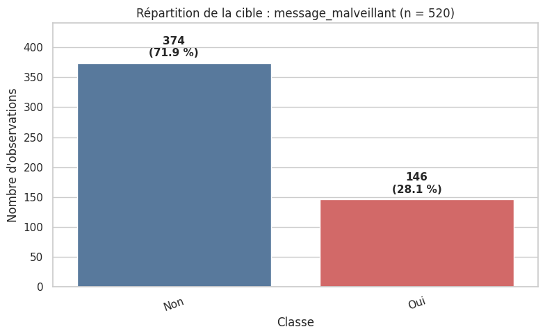
    


    Effectifs et pourcentages :


<div>
<style scoped>
    .dataframe tbody tr th:only-of-type {
        vertical-align: middle;
    }

    .dataframe tbody tr th {
        vertical-align: top;
    }

    .dataframe thead th {
        text-align: right;
    }
</style>
<table border="1" class="dataframe">
  <thead>
    <tr style="text-align: right;">
      <th></th>
      <th>effectif</th>
      <th>pourcentage_%</th>
    </tr>
    <tr>
      <th>message_malveillant</th>
      <th></th>
      <th></th>
    </tr>
  </thead>
  <tbody>
    <tr>
      <th>Non</th>
      <td>374</td>
      <td>71.92</td>
    </tr>
    <tr>
      <th>Oui</th>
      <td>146</td>
      <td>28.08</td>
    </tr>
  </tbody>
</table>
</div>


### Interprétation — Histogrammes (variables numériques)

**Axes**
- **Abscisse (axe horizontal, X)** : les **valeurs** de la variable.  
  Exemple : pour `urgence_score`, l’axe X va de 0 à 10. Avec `bins=20`, les valeurs sont regroupées en 20 petites tranches.
- **Ordonnée (axe vertical, Y)** : le **nombre de messages** (effectif) dans chaque tranche.  
  Plus la barre est haute, plus il y a de messages avec cette valeur.

**Utilité** : voir la distribution d’une variable (où les valeurs sont concentrées, étalées, rares/extrêmes).

**Comment lire**
- Barre haute = beaucoup de messages dans cette plage.
- Barre basse = peu de messages.
- Pic = valeur/plage la plus fréquente.
- Valeurs isolées = rares/extrêmes.

**Exemples dataset** : `domaine_age_jours` faible peut signaler domaine récent ; `urgence_score` élevé = pression ; `fautes_langue` souvent faible avec IA.


```python
# Graphique 2 : distributions des variables numériques
colonnes_num = df.select_dtypes(include=np.number).columns.tolist()
if colonnes_num:
    df[colonnes_num].hist(figsize=(14, 10), bins=20, edgecolor="black")
    plt.suptitle("Distribution des variables numériques", y=1.02)
    plt.tight_layout()
    plt.show()
else:
    print("Aucune variable numérique.")
```


    
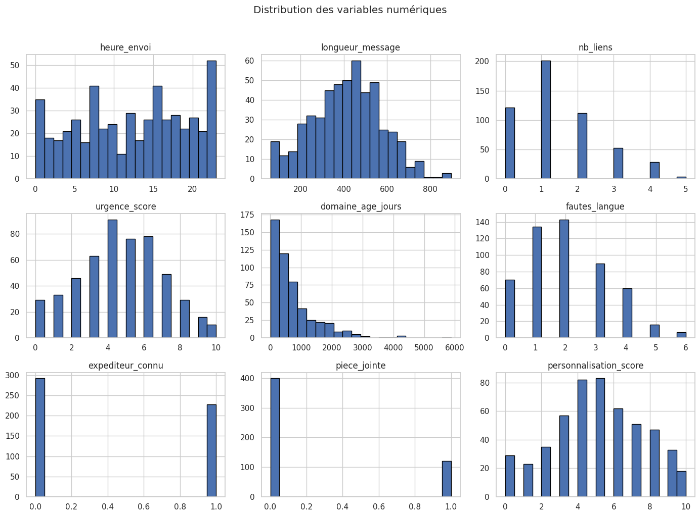
    


### Interprétation des boxplots

| Variable | Ce qu'on voit | Pouvoir discriminant |
|---|---|---|
| `domaine_age_jours` | Médiane d'environ 650 jours pour « Non » contre environ 220 pour « Oui ». La boîte « Oui » est très basse (80 à 500 jours). | Fort |
| `urgence_score` | Médiane de 4 pour « Non » contre 6 pour « Oui ». Le quart inférieur des « Oui » commence à 4, celui des « Non » à 2. | Bon |
| `nb_liens` | Médiane de 1 pour « Non » contre 2 pour « Oui ». Les « Oui » vont de 1 à 3 liens, les « Non » de 0 à 2. | Moyen |
| `longueur_message` | Médiane d'environ 430 caractères pour « Non » contre environ 400 pour « Oui ». Les boîtes se chevauchent presque entièrement. | Faible |
| `heure_envoi` | Médiane de 12 h pour « Non » contre 13 h pour « Oui ». Même étendue (0 à 23 h), boîtes quasi identiques. | Quasi nul |
| `fautes_langue` | Boîtes identiques (médiane 2, de 1 à 3, maximum 6). | Nul |

**Lecture détaillée**

- **Âge du domaine** : un domaine récent est typique du phishing, car les attaquants enregistrent des domaines jetables. C'est la variable qui sépare le mieux. Sa distribution est très asymétrique : les points isolés jusqu'à 5 900 jours chez les « Non » sont de vieux domaines légitimes (16 ans), pas des erreurs. Il faut les garder, utiliser la médiane et envisager une transformation logarithmique.
- **Urgence et liens** : les messages malveillants poussent à agir vite et contiennent plus de liens. Ces deux signaux sont cohérents avec le phishing, mais chacun se chevauche beaucoup avec les messages normaux.
- **Longueur et heure d'envoi** : le décalage est faible, donc ces variables aident peu seules.
- **Fautes de langue** : aucune différence. C'est le résultat le plus intéressant pour un projet « IA et confiance numérique » : les faux messages écrits par une IA sont souvent sans fautes, donc la faute d'orthographe ne permet plus de détecter le phishing. C'est une explication possible ; il faudrait la confirmer avec la façon dont le dataset a été construit.

**Conclusion** : aucune variable ne suffit seule, sauf peut-être l'âge du domaine. Classement : `domaine_age_jours > urgence_score > nb_liens > longueur_message > heure_envoi > fautes_langue`.


```python
# Graphique 3 : relation entre variables numériques et cible
# Boxplots + valeurs lisibles (effectif, médiane, moyenne) dans chaque graphique.
if colonnes_num:
    nb = min(len(colonnes_num), 6)
    fig, axes = plt.subplots(nb, 1, figsize=(10, 4.2 * nb))
    axes = np.array(axes).reshape(-1)
    for ax, col in zip(axes, colonnes_num[:nb]):
        sns.boxplot(data=df, x=TARGET, y=col, ax=ax, palette=['#4C78A8', '#E45756'])
        lignes = []
        for cls in df[TARGET].dropna().unique():
            s = df.loc[df[TARGET] == cls, col].dropna()
            if len(s):
                lignes.append(f"{cls} : n = {len(s)} | médiane = {s.median():.1f} | moyenne = {s.mean():.1f}")
        ax.text(0.01, 0.98, "\n".join(lignes), transform=ax.transAxes,
                va="top", ha="left", fontsize=9,
                bbox=dict(boxstyle="round,pad=0.3", facecolor="white", alpha=0.9))
        ax.set_title(f"{col} selon {TARGET}")
        ax.set_xlabel("")
        ax.tick_params(axis="x", rotation=15)
    plt.tight_layout()
    plt.show()
```


    
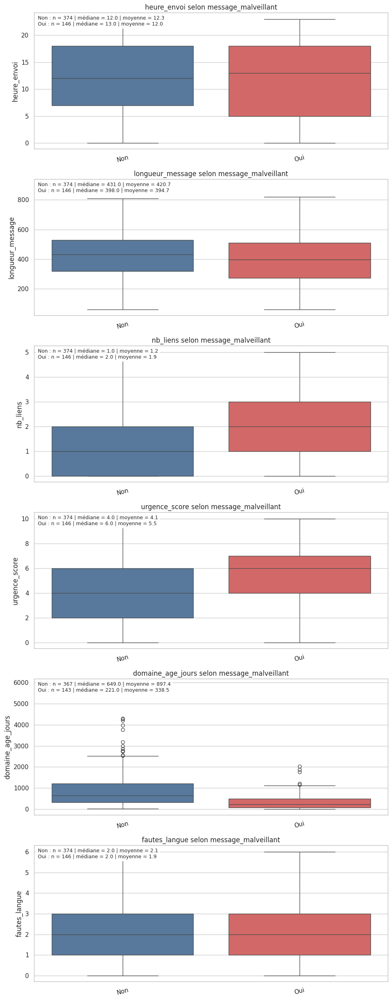
    


```python
# Colonnes à ignorer (calendrier) et cible
IGNORER = [TARGET, "date", "semaine"]

# 1) Catégorielles (texte)
cols_cat = [c for c in df.select_dtypes(include=["object", "category", "bool"]).columns
            if c not in IGNORER]

# 2) Numériques discrètes (ex. 0/1, scores 0-10, petits compteurs)
cols_discretes = [c for c in df.select_dtypes(include="number").columns
                  if c not in IGNORER and df[c].nunique(dropna=True) <= 15]

cols_a_tracer = [c for c in cols_cat + cols_discretes if df[c].nunique(dropna=True) <= 15]
print("Variables tracées :", cols_a_tracer)

if not cols_a_tracer:
    print("Aucune variable catégorielle ou discrète à tracer.")

total = len(df)
for col in cols_a_tracer:
    fig, ax = plt.subplots(figsize=(9, 4.5))
    sns.countplot(data=df, x=col, hue=TARGET, ax=ax)
    for p in ax.patches:
        h = p.get_height()
        if h and not np.isnan(h):
            ax.annotate(f"{int(h)}\n({h/total*100:.1f} %)",
                        (p.get_x() + p.get_width() / 2, h),
                        ha="center", va="bottom", fontsize=7.5)
    ax.set_ylim(0, ax.get_ylim()[1] * 1.18)
    ax.set_title(f"Répartition de {TARGET} selon {col} (n = {total})")
    ax.tick_params(axis="x", rotation=25)
    plt.tight_layout()
    plt.show()
```

    Variables tracées : ['nb_liens', 'urgence_score', 'fautes_langue', 'expediteur_connu', 'piece_jointe', 'personnalisation_score']


    
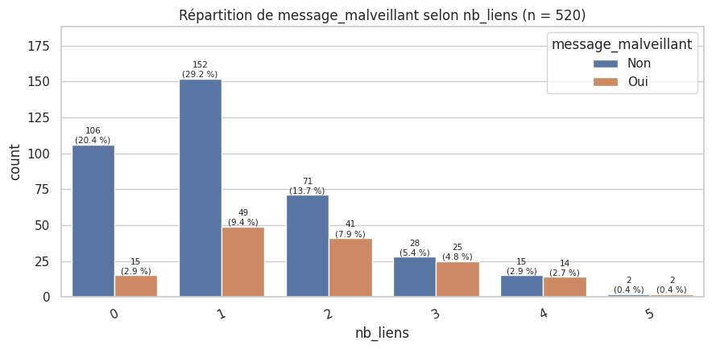
    


    
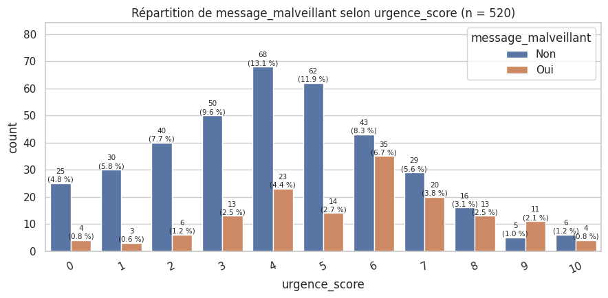
    


    
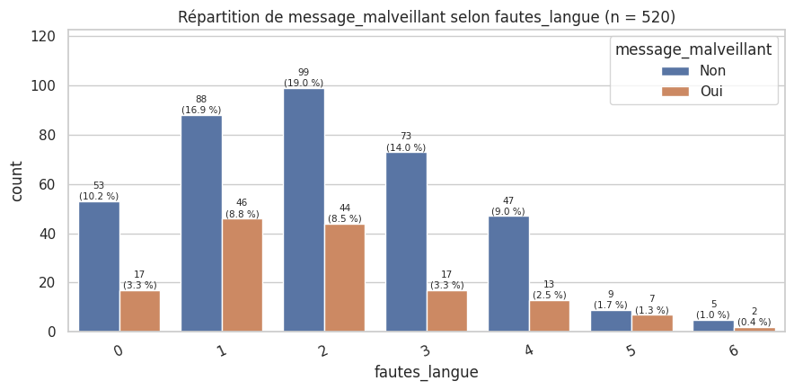
    


    
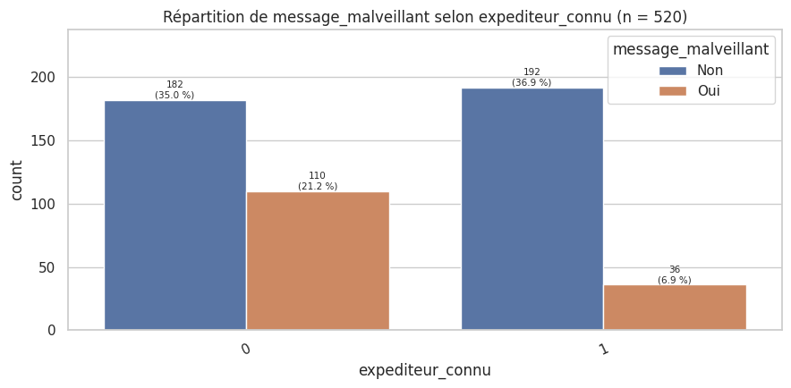
    


    
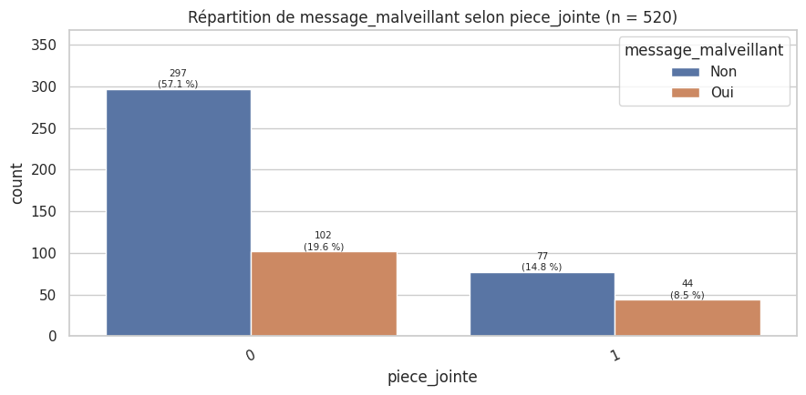
    


    
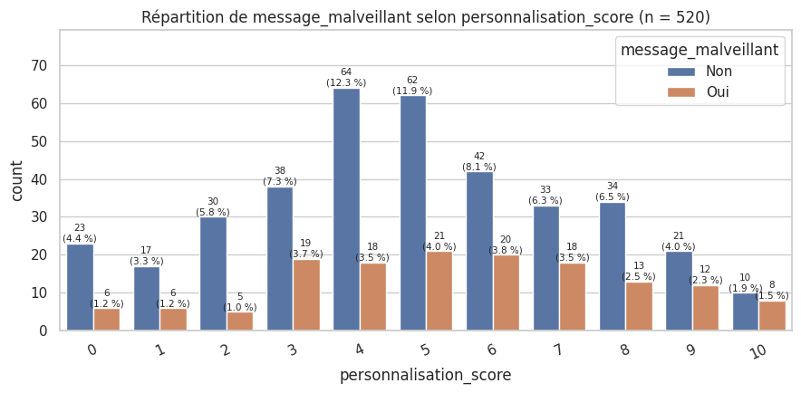
    


## 7. Étude des corrélations et des associations

La corrélation de Pearson mesure une association linéaire entre variables numériques. Elle ne s'applique pas directement aux catégories nominales. On encode temporairement la cible pour visualiser une association exploratoire, mais le code numérique des classes ne doit pas être interprété comme une distance naturelle entre elles. Une corrélation ne signifie pas causalité.

### Comment lire une matrice de corrélation

**1. La structure** : chaque case croise la variable de sa ligne avec celle de sa colonne. La matrice est symétrique (case A,B = case B,A), donc on lit surtout une moitié.

**2. La diagonale** : toujours 1,00 (rouge foncé) car une variable est parfaitement corrélée avec elle-même. On l’ignore.

**3. Le nombre (coefficient de Pearson r, entre -1 et +1)**
- `+1` : quand l’une augmente, l’autre augmente.
- `-1` : quand l’une augmente, l’autre diminue.
- `0` : aucun lien linéaire.
- Repères indicatifs : `|r| < 0,3` faible, `0,3 à 0,7` modérée, `> 0,7` forte.

**4. La couleur** : rouge = positif, bleu = négatif, gris clair = proche de 0. Plus la couleur est intense, plus le lien est fort.

### Ce que montre ton graphique
- **Entre variables explicatives** (tout sauf la cible), les cases restent gris clair : valeurs réelles entre **-0,060 et +0,067**. Les 9 variables sont donc pratiquement indépendantes.
- Corrélations les plus fortes entre explicatives (mais très faibles) : `expediteur_connu`/`domaine_age_jours` (**+0,067**), `urgence_score`/`expediteur_connu` (**+0,063**), `fautes_langue`/`nb_liens` (**-0,060**).
- **La cible est la dernière ligne et la dernière colonne** (`cible (Oui = 1)`) : on y lit `domaine_age_jours` **-0,329**, `urgence_score` **+0,272**, `nb_liens` **+0,259**, `expediteur_connu` **-0,242**.
- Cette matrice ne mesure que des liens linéaires : le **SVM RBF** peut capter des interactions non linéaires qu'elle ne montre pas.

### Conclusion
- **Pas de redondance / pas de multicolinéarité forte** entre explicatives : aucune variable n’en duplique une autre, on peut les garder.
- **Chaque variable apporte une information distincte**.
- **La cible figure dans la matrice** (dernière ligne / colonne) : on lit dans le même graphique la redondance entre variables et l'association de chacune avec la malveillance.

### Limites
- **Corrélation ≠ causalité** : un lien fort ne prouve pas qu'une variable *cause* le phishing.
- **Pearson = lien linéaire uniquement** ; un lien courbe peut donner `r ≈ 0`.
- **Variables binaires** (`expediteur_connu`, `piece_jointe`) : lecture approximative avec Pearson (corrélation point-bisérielle).
- **Encodage de la cible** : `Oui = 1` sert uniquement à calculer et visualiser la corrélation ; la cible n'entre jamais dans `X` (règle anti-fuite).
- Une matrice très « vide » peut aussi refléter un dataset synthétique ; à signaler dans les limites si c’est le cas.

> Phrase rapport : « Toutes les corrélations entre variables explicatives sont proches de zéro (|r| ≤ 0,07) : les variables sont indépendantes, sans redondance, et peuvent toutes être conservées pour la modélisation. La cible, ajoutée en dernière ligne, montre les associations attendues (-0,33 pour l'âge du domaine, +0,27 pour l'urgence). »


```python
# Corrélations entre les variables explicatives ET la cible
# La cible est incluse (encodée Oui = 1) pour voir son association avec chaque variable.
# Les variables calendaires (date, semaine) restent exclues.

IGNORER = ["date", "semaine"]

num_features_eda = [
    c for c in df.select_dtypes(include="number").columns
    if c not in IGNORER
]

# Encodage temporaire de la cible, uniquement pour la corrélation : Oui = 1, Non = 0
df_corr = df[num_features_eda].copy()
df_corr["cible (Oui = 1)"] = (df[TARGET] == "Oui").astype(int)

corr = df_corr.corr(method="pearson")

plt.figure(figsize=(12, 9))
sns.heatmap(
    corr,
    annot=True,
    cmap="coolwarm",
    center=0,
    vmin=-1,
    vmax=1,
    fmt=".2f",
    linewidths=0.5
)

plt.title("Matrice de corrélation de Pearson — variables explicatives + cible (Oui = 1)")
plt.tight_layout()
plt.show()

display(corr.round(3))

# La dernière ligne / colonne donne l'association de chaque variable avec la cible.
display(corr["cible (Oui = 1)"].drop("cible (Oui = 1)").sort_values(key=abs, ascending=False).round(3).to_frame())

```


    
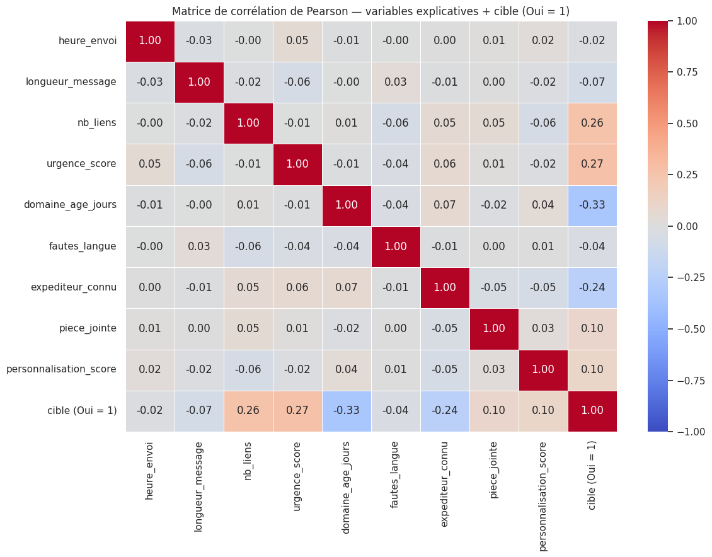
    


<div>
<style scoped>
    .dataframe tbody tr th:only-of-type {
        vertical-align: middle;
    }

    .dataframe tbody tr th {
        vertical-align: top;
    }

    .dataframe thead th {
        text-align: right;
    }
</style>
<table border="1" class="dataframe">
  <thead>
    <tr style="text-align: right;">
      <th></th>
      <th>heure_envoi</th>
      <th>longueur_message</th>
      <th>nb_liens</th>
      <th>urgence_score</th>
      <th>domaine_age_jours</th>
      <th>fautes_langue</th>
      <th>expediteur_connu</th>
      <th>piece_jointe</th>
      <th>personnalisation_score</th>
      <th>cible (Oui = 1)</th>
    </tr>
  </thead>
  <tbody>
    <tr>
      <th>heure_envoi</th>
      <td>1.000</td>
      <td>-0.029</td>
      <td>-0.002</td>
      <td>0.047</td>
      <td>-0.008</td>
      <td>-0.004</td>
      <td>0.001</td>
      <td>0.013</td>
      <td>0.024</td>
      <td>-0.017</td>
    </tr>
    <tr>
      <th>longueur_message</th>
      <td>-0.029</td>
      <td>1.000</td>
      <td>-0.016</td>
      <td>-0.059</td>
      <td>-0.001</td>
      <td>0.035</td>
      <td>-0.008</td>
      <td>0.000</td>
      <td>-0.022</td>
      <td>-0.072</td>
    </tr>
    <tr>
      <th>nb_liens</th>
      <td>-0.002</td>
      <td>-0.016</td>
      <td>1.000</td>
      <td>-0.006</td>
      <td>0.010</td>
      <td>-0.060</td>
      <td>0.055</td>
      <td>0.049</td>
      <td>-0.055</td>
      <td>0.259</td>
    </tr>
    <tr>
      <th>urgence_score</th>
      <td>0.047</td>
      <td>-0.059</td>
      <td>-0.006</td>
      <td>1.000</td>
      <td>-0.012</td>
      <td>-0.036</td>
      <td>0.063</td>
      <td>0.014</td>
      <td>-0.020</td>
      <td>0.272</td>
    </tr>
    <tr>
      <th>domaine_age_jours</th>
      <td>-0.008</td>
      <td>-0.001</td>
      <td>0.010</td>
      <td>-0.012</td>
      <td>1.000</td>
      <td>-0.038</td>
      <td>0.067</td>
      <td>-0.021</td>
      <td>0.042</td>
      <td>-0.329</td>
    </tr>
    <tr>
      <th>fautes_langue</th>
      <td>-0.004</td>
      <td>0.035</td>
      <td>-0.060</td>
      <td>-0.036</td>
      <td>-0.038</td>
      <td>1.000</td>
      <td>-0.009</td>
      <td>0.001</td>
      <td>0.008</td>
      <td>-0.035</td>
    </tr>
    <tr>
      <th>expediteur_connu</th>
      <td>0.001</td>
      <td>-0.008</td>
      <td>0.055</td>
      <td>0.063</td>
      <td>0.067</td>
      <td>-0.009</td>
      <td>1.000</td>
      <td>-0.046</td>
      <td>-0.055</td>
      <td>-0.242</td>
    </tr>
    <tr>
      <th>piece_jointe</th>
      <td>0.013</td>
      <td>0.000</td>
      <td>0.049</td>
      <td>0.014</td>
      <td>-0.021</td>
      <td>0.001</td>
      <td>-0.046</td>
      <td>1.000</td>
      <td>0.030</td>
      <td>0.102</td>
    </tr>
    <tr>
      <th>personnalisation_score</th>
      <td>0.024</td>
      <td>-0.022</td>
      <td>-0.055</td>
      <td>-0.020</td>
      <td>0.042</td>
      <td>0.008</td>
      <td>-0.055</td>
      <td>0.030</td>
      <td>1.000</td>
      <td>0.102</td>
    </tr>
    <tr>
      <th>cible (Oui = 1)</th>
      <td>-0.017</td>
      <td>-0.072</td>
      <td>0.259</td>
      <td>0.272</td>
      <td>-0.329</td>
      <td>-0.035</td>
      <td>-0.242</td>
      <td>0.102</td>
      <td>0.102</td>
      <td>1.000</td>
    </tr>
  </tbody>
</table>
</div>


<div>
<style scoped>
    .dataframe tbody tr th:only-of-type {
        vertical-align: middle;
    }

    .dataframe tbody tr th {
        vertical-align: top;
    }

    .dataframe thead th {
        text-align: right;
    }
</style>
<table border="1" class="dataframe">
  <thead>
    <tr style="text-align: right;">
      <th></th>
      <th>cible (Oui = 1)</th>
    </tr>
  </thead>
  <tbody>
    <tr>
      <th>domaine_age_jours</th>
      <td>-0.329</td>
    </tr>
    <tr>
      <th>urgence_score</th>
      <td>0.272</td>
    </tr>
    <tr>
      <th>nb_liens</th>
      <td>0.259</td>
    </tr>
    <tr>
      <th>expediteur_connu</th>
      <td>-0.242</td>
    </tr>
    <tr>
      <th>personnalisation_score</th>
      <td>0.102</td>
    </tr>
    <tr>
      <th>piece_jointe</th>
      <td>0.102</td>
    </tr>
    <tr>
      <th>longueur_message</th>
      <td>-0.072</td>
    </tr>
    <tr>
      <th>fautes_langue</th>
      <td>-0.035</td>
    </tr>
    <tr>
      <th>heure_envoi</th>
      <td>-0.017</td>
    </tr>
  </tbody>
</table>
</div>


**Lecture de la matrice** : la dernière ligne et la dernière colonne sont la **cible encodée**
(`Oui = 1`, `Non = 0`). On y lit directement l'association de chaque variable avec la malveillance,
en plus des corrélations entre variables explicatives (détection de redondance).

- Les cases **hors cible** restent très faibles (|r| ≤ 0,07) : les 9 variables sont quasiment
  indépendantes, pas de colinéarité problématique.
- Avec la cible, les liens sont plus nets : `domaine_age_jours` **−0,329**, `urgence_score`
  **+0,272**, `nb_liens` **+0,259**, `expediteur_connu` **−0,242**.
- ⚠️ La cible est binaire : le coefficient est une **corrélation point-bisérielle** (cas
  particulier de Pearson), à lire comme un lien linéaire, jamais comme une causalité. Encoder
  `Oui = 1` sert seulement à visualiser ; le modèle ne voit jamais la cible dans `X`.


```python
# Association de chaque variable avec la cible (Oui = 1)
# Pearson avec une variable binaire = corrélation point-bisérielle.
y_01 = (df[TARGET] == "Oui").astype(int)

association = (
    df[num_features_eda]
    .corrwith(y_01, method="pearson")
    .rename("corrélation_avec_Oui")
    .sort_values(key=abs, ascending=False)
    .to_frame()
)
display(association.round(3))

fig, ax = plt.subplots(figsize=(8, 4.5))
vals = association["corrélation_avec_Oui"][::-1]
colors = ["#d62728" if v > 0 else "#1f77b4" for v in vals]
ax.barh(vals.index, vals.values, color=colors)
for i, v in enumerate(vals.values):
    ax.text(v + (0.006 if v >= 0 else -0.006), i, f"{v:+.3f}",
            va="center", ha="left" if v >= 0 else "right", fontsize=8)
ax.axvline(0, color="k", lw=0.8)
ax.set_xlim(-0.42, 0.42)
ax.set_title("Association avec la cible (Oui = 1) — Pearson / point-bisérielle")
ax.set_xlabel("coefficient r")
plt.tight_layout()
plt.show()
```


<div>
<style scoped>
    .dataframe tbody tr th:only-of-type {
        vertical-align: middle;
    }

    .dataframe tbody tr th {
        vertical-align: top;
    }

    .dataframe thead th {
        text-align: right;
    }
</style>
<table border="1" class="dataframe">
  <thead>
    <tr style="text-align: right;">
      <th></th>
      <th>corrélation_avec_Oui</th>
    </tr>
  </thead>
  <tbody>
    <tr>
      <th>domaine_age_jours</th>
      <td>-0.329</td>
    </tr>
    <tr>
      <th>urgence_score</th>
      <td>0.272</td>
    </tr>
    <tr>
      <th>nb_liens</th>
      <td>0.259</td>
    </tr>
    <tr>
      <th>expediteur_connu</th>
      <td>-0.242</td>
    </tr>
    <tr>
      <th>personnalisation_score</th>
      <td>0.102</td>
    </tr>
    <tr>
      <th>piece_jointe</th>
      <td>0.102</td>
    </tr>
    <tr>
      <th>longueur_message</th>
      <td>-0.072</td>
    </tr>
    <tr>
      <th>fautes_langue</th>
      <td>-0.035</td>
    </tr>
    <tr>
      <th>heure_envoi</th>
      <td>-0.017</td>
    </tr>
  </tbody>
</table>
</div>


    
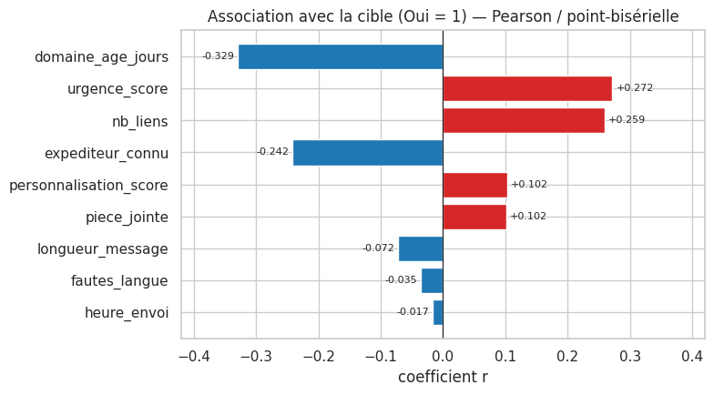
    


**🔎 Interprétation** : les associations les plus fortes avec la malveillance sont `domaine_age_jours` (**−0,329**), `urgence_score` (**+0,272**), `nb_liens` (**+0,259**) et `expediteur_connu` (**−0,242**). `personnalisation_score` et `piece_jointe` sont proches de zéro : avec l'IA générative, un message peut être bien écrit et personnalisé sans être légitime.

**Comment lire** : une barre rouge (r > 0) signifie que la variable augmente quand le message est malveillant ; une barre bleue (r < 0) qu'elle diminue. La longueur donne la force du lien linéaire.

**⚠️ Attention méthodologique** : `expediteur_connu` et `piece_jointe` sont des variables **binaires 0/1**. Leur coefficient est une **corrélation point-bisérielle** (cas particulier de Pearson) : il se lit comme une différence de proportion entre les deux classes, pas comme une pente. Corrélation ≠ causalité, et rien ici ne prouve qu'une variable *cause* le phishing. La cible figure déjà dans la matrice de la cellule précédente (dernière ligne / colonne) ; ce graphique en détaille l'association, variable par variable.


### Comment lire le tableau des moyennes par classe

Ce tableau compare la moyenne des variables pour les messages `Non` (normaux) et `Oui` (malveillants).

| Variable | Lecture sur ton résultat |
|---|---|
| `heure_envoi` | 12.29 vs 12.03 : presque pareil, peu discriminant. |
| `longueur_message` | 420.65 (Non) vs 394.66 (Oui) : légèrement plus courts pour Oui, différence faible. |
| `nb_liens` | 1.20 vs 1.86 : les malveillants ont en moyenne plus de liens. |
| `urgence_score` | 4.11 vs 5.54 : les malveillants sont plus urgents. |
| `domaine_age_jours` | 897.38 vs 338.54 : les malveillants viennent souvent de domaines plus récents. |
| `fautes_langue` | 2.05 vs 1.95 : très proche, peu discriminant ici (IA peut écrire correctement). |
| `expediteur_connu` | 0.51 vs 0.25 : les malveillants viennent plus souvent d’expéditeurs inconnus. |
| `piece_jointe` | 0.21 vs 0.30 : un peu plus de pièces jointes côté malveillant. |
| `personnalisation_score` | 4.82 vs 5.40 : légèrement plus personnalisés côté malveillant. |

**À retenir** : les signaux les plus marqués ici sont `domaine_age_jours`, `urgence_score`, `nb_liens`, `expediteur_connu`. Une moyenne ne suffit pas à décider seule ; le modèle combine toutes les variables.


```python
# Comparaison exploratoire des variables numériques par classe
if num_features_eda:
    moyennes_par_classe = df.groupby(TARGET, observed=False)[num_features_eda].mean().T
    display(moyennes_par_classe.round(2))
```


<div>
<style scoped>
    .dataframe tbody tr th:only-of-type {
        vertical-align: middle;
    }

    .dataframe tbody tr th {
        vertical-align: top;
    }

    .dataframe thead th {
        text-align: right;
    }
</style>
<table border="1" class="dataframe">
  <thead>
    <tr style="text-align: right;">
      <th>message_malveillant</th>
      <th>Non</th>
      <th>Oui</th>
    </tr>
  </thead>
  <tbody>
    <tr>
      <th>heure_envoi</th>
      <td>12.29</td>
      <td>12.03</td>
    </tr>
    <tr>
      <th>longueur_message</th>
      <td>420.65</td>
      <td>394.66</td>
    </tr>
    <tr>
      <th>nb_liens</th>
      <td>1.20</td>
      <td>1.86</td>
    </tr>
    <tr>
      <th>urgence_score</th>
      <td>4.11</td>
      <td>5.54</td>
    </tr>
    <tr>
      <th>domaine_age_jours</th>
      <td>897.38</td>
      <td>338.54</td>
    </tr>
    <tr>
      <th>fautes_langue</th>
      <td>2.05</td>
      <td>1.95</td>
    </tr>
    <tr>
      <th>expediteur_connu</th>
      <td>0.51</td>
      <td>0.25</td>
    </tr>
    <tr>
      <th>piece_jointe</th>
      <td>0.21</td>
      <td>0.30</td>
    </tr>
    <tr>
      <th>personnalisation_score</th>
      <td>4.82</td>
      <td>5.40</td>
    </tr>
  </tbody>
</table>
</div>


## 8. Construction des features et de la target

- `y` contient uniquement la variable cible.
- `X` contient les variables explicatives.
- Les colonnes de date et de semaine sont exclues conformément au cahier des charges : sans justification métier, elles risquent de faire apprendre le calendrier plutôt que le phénomène.
- La cible est explicitement retirée de `X` pour éviter la fuite de données.

## 4. Préparer les données pour le modèle

- **X** : les colonnes utilisées pour prédire (les signaux).
- **y** : la colonne à prédire (`message_malveillant`).
- La colonne `date` est retirée : une date seule n’aide pas à dire si un message est malveillant dans ce petit dataset.


```python
# Retirer la colonne à prédire et la date
colonnes_a_retirer = ['message_malveillant', 'date']
X = df.drop(columns=[c for c in colonnes_a_retirer if c in df.columns]).copy()
y = df['message_malveillant'].copy()

print('Colonnes utilisées (X) :', X.columns.tolist())
print('Colonne à prédire (y) : message_malveillant')

```

    Colonnes utilisées (X) : ['heure_envoi', 'longueur_message', 'nb_liens', 'urgence_score', 'domaine_age_jours', 'fautes_langue', 'expediteur_connu', 'piece_jointe', 'personnalisation_score']
    Colonne à prédire (y) : message_malveillant


```python
# Colonnes numériques et catégorielles
features_num = X.select_dtypes(include='number').columns.tolist()
features_cat = X.select_dtypes(exclude='number').columns.tolist()

print('Numériques :', features_num)
print('Catégorielles :', features_cat)

```

    Numériques : ['heure_envoi', 'longueur_message', 'nb_liens', 'urgence_score', 'domaine_age_jours', 'fautes_langue', 'expediteur_connu', 'piece_jointe', 'personnalisation_score']
    Catégorielles : []


## 9. Séparation Train / Test

On réserve 20 % des observations au test. `stratify=y` conserve autant que possible la proportion de chaque classe dans les deux ensembles. Le test ne sera pas utilisé pour ajuster les transformations ou choisir les paramètres.


```python
X_train, X_test, y_train, y_test = train_test_split(
    X, y,
    test_size=0.20,
    random_state=RANDOM_STATE,
    stratify=y
)

display("Train :", X_train.shape, y_train.shape)
display("Test  :", X_test.shape, y_test.shape)
print("\nRépartition des classes — train (%)")
display((y_train.value_counts(normalize=True) * 100).round(2))
print("\nRépartition des classes — test (%)")
display((y_test.value_counts(normalize=True) * 100).round(2))
```


    'Train :'


    (416, 9)


    (416,)


    'Test  :'


    (104, 9)


    (104,)


    
    Répartition des classes — train (%)


    message_malveillant
    Non    71.88
    Oui    28.12
    Name: proportion, dtype: float64


    
    Répartition des classes — test (%)


    message_malveillant
    Non    72.12
    Oui    27.88
    Name: proportion, dtype: float64


## 10. Prétraitement avec ColumnTransformer

- Variables numériques : imputation par la médiane puis standardisation.
- Variables catégorielles : imputation par la modalité la plus fréquente puis One-Hot Encoding.
- `handle_unknown="ignore"` permet de traiter une catégorie inconnue rencontrée ultérieurement.

Les transformations sont intégrées aux pipelines : elles sont ajustées uniquement lors de l'entraînement.


```python
transformations = []

if features_num:
    pipeline_num = Pipeline(steps=[
        ("imputation", SimpleImputer(strategy="median")),
        ("standardisation", StandardScaler())
    ])
    transformations.append(("numerique", pipeline_num, features_num))


preprocesseur = ColumnTransformer(transformers=transformations, remainder="drop")
print("Préprocesseur prêt.")
display(preprocesseur)
```

    Préprocesseur prêt.


<style>#sk-container-id-1 {
  /* Definition of color scheme common for light and dark mode */
  --sklearn-color-text: #000;
  --sklearn-color-text-muted: #666;
  --sklearn-color-line: gray;
  /* Definition of color scheme for unfitted estimators */
  --sklearn-color-unfitted-level-0: #fff5e6;
  --sklearn-color-unfitted-level-1: #f6e4d2;
  --sklearn-color-unfitted-level-2: #ffe0b3;
  --sklearn-color-unfitted-level-3: chocolate;
  /* Definition of color scheme for fitted estimators */
  --sklearn-color-fitted-level-0: #f0f8ff;
  --sklearn-color-fitted-level-1: #d4ebff;
  --sklearn-color-fitted-level-2: #b3dbfd;
  --sklearn-color-fitted-level-3: cornflowerblue;
}

#sk-container-id-1.light {
  /* Specific color for light theme */
  --sklearn-color-text-on-default-background: black;
  --sklearn-color-background: white;
  --sklearn-color-border-box: black;
  --sklearn-color-icon: #696969;
}

#sk-container-id-1.dark {
  --sklearn-color-text-on-default-background: white;
  --sklearn-color-background: #111;
  --sklearn-color-border-box: white;
  --sklearn-color-icon: #878787;
}

#sk-container-id-1 {
  color: var(--sklearn-color-text);
}

#sk-container-id-1 pre {
  padding: 0;
}

#sk-container-id-1 input.sk-hidden--visually {
  border: 0;
  clip: rect(1px 1px 1px 1px);
  clip: rect(1px, 1px, 1px, 1px);
  height: 1px;
  margin: -1px;
  overflow: hidden;
  padding: 0;
  position: absolute;
  width: 1px;
}

#sk-container-id-1 div.sk-dashed-wrapped {
  border: 1px dashed var(--sklearn-color-line);
  margin: 0 0.4em 0.5em 0.4em;
  box-sizing: border-box;
  padding-bottom: 0.4em;
  background-color: var(--sklearn-color-background);
}

#sk-container-id-1 div.sk-container {
  /* jupyter's `normalize.less` sets `[hidden] { display: none; }`
     but bootstrap.min.css set `[hidden] { display: none !important; }`
     so we also need the `!important` here to be able to override the
     default hidden behavior on the sphinx rendered scikit-learn.org.
     See: https://github.com/scikit-learn/scikit-learn/issues/21755 */
  display: inline-block !important;
  position: relative;
}

#sk-container-id-1 div.sk-text-repr-fallback {
  display: none;
}

div.sk-parallel-item,
div.sk-serial,
div.sk-item {
  /* draw centered vertical line to link estimators */
  background-image: linear-gradient(var(--sklearn-color-text-on-default-background), var(--sklearn-color-text-on-default-background));
  background-size: 2px 100%;
  background-repeat: no-repeat;
  background-position: center center;
}

/* Parallel-specific style estimator block */

#sk-container-id-1 div.sk-parallel-item::after {
  content: "";
  width: 100%;
  border-bottom: 2px solid var(--sklearn-color-text-on-default-background);
  flex-grow: 1;
}

#sk-container-id-1 div.sk-parallel {
  display: flex;
  align-items: stretch;
  justify-content: center;
  background-color: var(--sklearn-color-background);
  position: relative;
}

#sk-container-id-1 div.sk-parallel-item {
  display: flex;
  flex-direction: column;
}

#sk-container-id-1 div.sk-parallel-item:first-child::after {
  align-self: flex-end;
  width: 50%;
}

#sk-container-id-1 div.sk-parallel-item:last-child::after {
  align-self: flex-start;
  width: 50%;
}

#sk-container-id-1 div.sk-parallel-item:only-child::after {
  width: 0;
}

/* Serial-specific style estimator block */

#sk-container-id-1 div.sk-serial {
  display: flex;
  flex-direction: column;
  align-items: center;
  background-color: var(--sklearn-color-background);
  padding-right: 1em;
  padding-left: 1em;
}


/* Toggleable style: style used for estimator/Pipeline/ColumnTransformer box that is
clickable and can be expanded/collapsed.
- Pipeline and ColumnTransformer use this feature and define the default style
- Estimators will overwrite some part of the style using the `sk-estimator` class
*/

/* Pipeline and ColumnTransformer style (default) */

#sk-container-id-1 div.sk-toggleable {
  /* Default theme specific background. It is overwritten whether we have a
  specific estimator or a Pipeline/ColumnTransformer */
  background-color: var(--sklearn-color-background);
}

/* Toggleable label */
#sk-container-id-1 label.sk-toggleable__label {
  cursor: pointer;
  display: flex;
  width: 100%;
  margin-bottom: 0;
  padding: 0.5em;
  box-sizing: border-box;
  text-align: center;
  align-items: center;
  justify-content: center;
  gap: 0.5em;
}

#sk-container-id-1 label.sk-toggleable__label .caption {
  font-size: 0.6rem;
  font-weight: lighter;
  color: var(--sklearn-color-text-muted);
}

#sk-container-id-1 label.sk-toggleable__label-arrow:before {
  /* Arrow on the left of the label */
  content: "▸";
  float: left;
  margin-right: 0.25em;
  color: var(--sklearn-color-icon);
}

#sk-container-id-1 label.sk-toggleable__label-arrow:hover:before {
  color: var(--sklearn-color-text);
}

/* Toggleable content - dropdown */

#sk-container-id-1 div.sk-toggleable__content {
  display: none;
  text-align: left;
  /* unfitted */
  background-color: var(--sklearn-color-unfitted-level-0);
}

#sk-container-id-1 div.sk-toggleable__content.fitted {
  /* fitted */
  background-color: var(--sklearn-color-fitted-level-0);
}

#sk-container-id-1 div.sk-toggleable__content pre {
  margin: 0.2em;
  border-radius: 0.25em;
  color: var(--sklearn-color-text);
  /* unfitted */
  background-color: var(--sklearn-color-unfitted-level-0);
}

#sk-container-id-1 div.sk-toggleable__content.fitted pre {
  /* unfitted */
  background-color: var(--sklearn-color-fitted-level-0);
}

#sk-container-id-1 input.sk-toggleable__control:checked~div.sk-toggleable__content {
  /* Expand drop-down */
  display: block;
  width: 100%;
  overflow: visible;
}

#sk-container-id-1 input.sk-toggleable__control:checked~label.sk-toggleable__label-arrow:before {
  content: "▾";
}

/* Pipeline/ColumnTransformer-specific style */

#sk-container-id-1 div.sk-label input.sk-toggleable__control:checked~label.sk-toggleable__label {
  color: var(--sklearn-color-text);
  background-color: var(--sklearn-color-unfitted-level-2);
}

#sk-container-id-1 div.sk-label.fitted input.sk-toggleable__control:checked~label.sk-toggleable__label {
  background-color: var(--sklearn-color-fitted-level-2);
}

/* Estimator-specific style */

/* Colorize estimator box */
#sk-container-id-1 div.sk-estimator input.sk-toggleable__control:checked~label.sk-toggleable__label {
  /* unfitted */
  background-color: var(--sklearn-color-unfitted-level-2);
}

#sk-container-id-1 div.sk-estimator.fitted input.sk-toggleable__control:checked~label.sk-toggleable__label {
  /* fitted */
  background-color: var(--sklearn-color-fitted-level-2);
}

#sk-container-id-1 div.sk-label label.sk-toggleable__label,
#sk-container-id-1 div.sk-label label {
  /* The background is the default theme color */
  color: var(--sklearn-color-text-on-default-background);
}

/* On hover, darken the color of the background */
#sk-container-id-1 div.sk-label:hover label.sk-toggleable__label {
  color: var(--sklearn-color-text);
  background-color: var(--sklearn-color-unfitted-level-2);
}

/* Label box, darken color on hover, fitted */
#sk-container-id-1 div.sk-label.fitted:hover label.sk-toggleable__label.fitted {
  color: var(--sklearn-color-text);
  background-color: var(--sklearn-color-fitted-level-2);
}

/* Estimator label */

#sk-container-id-1 div.sk-label label {
  font-family: monospace;
  font-weight: bold;
  line-height: 1.2em;
}

#sk-container-id-1 div.sk-label-container {
  text-align: center;
}

/* Estimator-specific */
#sk-container-id-1 div.sk-estimator {
  font-family: monospace;
  border: 1px dotted var(--sklearn-color-border-box);
  border-radius: 0.25em;
  box-sizing: border-box;
  margin-bottom: 0.5em;
  /* unfitted */
  background-color: var(--sklearn-color-unfitted-level-0);
}

#sk-container-id-1 div.sk-estimator.fitted {
  /* fitted */
  background-color: var(--sklearn-color-fitted-level-0);
}

/* on hover */
#sk-container-id-1 div.sk-estimator:hover {
  /* unfitted */
  background-color: var(--sklearn-color-unfitted-level-2);
}

#sk-container-id-1 div.sk-estimator.fitted:hover {
  /* fitted */
  background-color: var(--sklearn-color-fitted-level-2);
}

/* Specification for estimator info (e.g. "i" and "?") */

/* Common style for "i" and "?" */

.sk-estimator-doc-link,
a:link.sk-estimator-doc-link,
a:visited.sk-estimator-doc-link {
  float: right;
  font-size: smaller;
  line-height: 1em;
  font-family: monospace;
  background-color: var(--sklearn-color-unfitted-level-0);
  border-radius: 1em;
  height: 1em;
  width: 1em;
  text-decoration: none !important;
  margin-left: 0.5em;
  text-align: center;
  /* unfitted */
  border: var(--sklearn-color-unfitted-level-3) 1pt solid;
  color: var(--sklearn-color-unfitted-level-3);
}

.sk-estimator-doc-link.fitted,
a:link.sk-estimator-doc-link.fitted,
a:visited.sk-estimator-doc-link.fitted {
  /* fitted */
  background-color: var(--sklearn-color-fitted-level-0);
  border: var(--sklearn-color-fitted-level-3) 1pt solid;
  color: var(--sklearn-color-fitted-level-3);
}

/* On hover */
div.sk-estimator:hover .sk-estimator-doc-link:hover,
.sk-estimator-doc-link:hover,
div.sk-label-container:hover .sk-estimator-doc-link:hover,
.sk-estimator-doc-link:hover {
  /* unfitted */
  background-color: var(--sklearn-color-unfitted-level-3);
  border: var(--sklearn-color-fitted-level-0) 1pt solid;
  color: var(--sklearn-color-unfitted-level-0);
  text-decoration: none;
}

div.sk-estimator.fitted:hover .sk-estimator-doc-link.fitted:hover,
.sk-estimator-doc-link.fitted:hover,
div.sk-label-container:hover .sk-estimator-doc-link.fitted:hover,
.sk-estimator-doc-link.fitted:hover {
  /* fitted */
  background-color: var(--sklearn-color-fitted-level-3);
  border: var(--sklearn-color-fitted-level-0) 1pt solid;
  color: var(--sklearn-color-fitted-level-0);
  text-decoration: none;
}

/* Span, style for the box shown on hovering the info icon */
.sk-estimator-doc-link span {
  display: none;
  z-index: 9999;
  position: relative;
  font-weight: normal;
  right: .2ex;
  padding: .5ex;
  margin: .5ex;
  width: min-content;
  min-width: 20ex;
  max-width: 50ex;
  color: var(--sklearn-color-text);
  box-shadow: 2pt 2pt 4pt #999;
  /* unfitted */
  background: var(--sklearn-color-unfitted-level-0);
  border: .5pt solid var(--sklearn-color-unfitted-level-3);
}

.sk-estimator-doc-link.fitted span {
  /* fitted */
  background: var(--sklearn-color-fitted-level-0);
  border: var(--sklearn-color-fitted-level-3);
}

.sk-estimator-doc-link:hover span {
  display: block;
}

/* "?"-specific style due to the `<a>` HTML tag */

#sk-container-id-1 a.estimator_doc_link {
  float: right;
  font-size: 1rem;
  line-height: 1em;
  font-family: monospace;
  background-color: var(--sklearn-color-unfitted-level-0);
  border-radius: 1rem;
  height: 1rem;
  width: 1rem;
  text-decoration: none;
  /* unfitted */
  color: var(--sklearn-color-unfitted-level-1);
  border: var(--sklearn-color-unfitted-level-1) 1pt solid;
}

#sk-container-id-1 a.estimator_doc_link.fitted {
  /* fitted */
  background-color: var(--sklearn-color-fitted-level-0);
  border: var(--sklearn-color-fitted-level-1) 1pt solid;
  color: var(--sklearn-color-fitted-level-1);
}

/* On hover */
#sk-container-id-1 a.estimator_doc_link:hover {
  /* unfitted */
  background-color: var(--sklearn-color-unfitted-level-3);
  color: var(--sklearn-color-background);
  text-decoration: none;
}

#sk-container-id-1 a.estimator_doc_link.fitted:hover {
  /* fitted */
  background-color: var(--sklearn-color-fitted-level-3);
}

.estimator-table {
    font-family: monospace;
}

.estimator-table summary {
    padding: .5rem;
    cursor: pointer;
}

.estimator-table summary::marker {
    font-size: 0.7rem;
}

.estimator-table details[open] {
    padding-left: 0.1rem;
    padding-right: 0.1rem;
    padding-bottom: 0.3rem;
}

.estimator-table .parameters-table {
    margin-left: auto !important;
    margin-right: auto !important;
    margin-top: 0;
}

.estimator-table .parameters-table tr:nth-child(odd) {
    background-color: #fff;
}

.estimator-table .parameters-table tr:nth-child(even) {
    background-color: #f6f6f6;
}

.estimator-table .parameters-table tr:hover {
    background-color: #e0e0e0;
}

.estimator-table table td {
    border: 1px solid rgba(106, 105, 104, 0.232);
}

/*
    `table td`is set in notebook with right text-align.
    We need to overwrite it.
*/
.estimator-table table td.param {
    text-align: left;
    position: relative;
    padding: 0;
}

.user-set td {
    color:rgb(255, 94, 0);
    text-align: left !important;
}

.user-set td.value {
    color:rgb(255, 94, 0);
    background-color: transparent;
}

.default td {
    color: black;
    text-align: left !important;
}

.user-set td i,
.default td i {
    color: black;
}

/*
    Styles for parameter documentation links
    We need styling for visited so jupyter doesn't overwrite it
*/
a.param-doc-link,
a.param-doc-link:link,
a.param-doc-link:visited {
    text-decoration: underline dashed;
    text-underline-offset: .3em;
    color: inherit;
    display: block;
    padding: .5em;
}

/* "hack" to make the entire area of the cell containing the link clickable */
a.param-doc-link::before {
    position: absolute;
    content: "";
    inset: 0;
}

.param-doc-description {
    display: none;
    position: absolute;
    z-index: 9999;
    left: 0;
    padding: .5ex;
    margin-left: 1.5em;
    color: var(--sklearn-color-text);
    box-shadow: .3em .3em .4em #999;
    width: max-content;
    text-align: left;
    max-height: 10em;
    overflow-y: auto;

    /* unfitted */
    background: var(--sklearn-color-unfitted-level-0);
    border: thin solid var(--sklearn-color-unfitted-level-3);
}

/* Fitted state for parameter tooltips */
.fitted .param-doc-description {
    /* fitted */
    background: var(--sklearn-color-fitted-level-0);
    border: thin solid var(--sklearn-color-fitted-level-3);
}

.param-doc-link:hover .param-doc-description {
    display: block;
}

.copy-paste-icon {
    background-image: url();
    background-repeat: no-repeat;
    background-size: 14px 14px;
    background-position: 0;
    display: inline-block;
    width: 14px;
    height: 14px;
    cursor: pointer;
}
</style><body><div id="sk-container-id-1" class="sk-top-container"><div class="sk-text-repr-fallback"><pre>ColumnTransformer(transformers=[(&#x27;numerique&#x27;,
                                 Pipeline(steps=[(&#x27;imputation&#x27;,
                                                  SimpleImputer(strategy=&#x27;median&#x27;)),
                                                 (&#x27;standardisation&#x27;,
                                                  StandardScaler())]),
                                 [&#x27;heure_envoi&#x27;, &#x27;longueur_message&#x27;, &#x27;nb_liens&#x27;,
                                  &#x27;urgence_score&#x27;, &#x27;domaine_age_jours&#x27;,
                                  &#x27;fautes_langue&#x27;, &#x27;expediteur_connu&#x27;,
                                  &#x27;piece_jointe&#x27;, &#x27;personnalisation_score&#x27;])])</pre><b>In a Jupyter environment, please rerun this cell to show the HTML representation or trust the notebook. <br />On GitHub, the HTML representation is unable to render, please try loading this page with nbviewer.org.</b></div><div class="sk-container" hidden><div class="sk-item sk-dashed-wrapped"><div class="sk-label-container"><div class="sk-label  sk-toggleable"><input class="sk-toggleable__control sk-hidden--visually" id="sk-estimator-id-1" type="checkbox" ><label for="sk-estimator-id-1" class="sk-toggleable__label  sk-toggleable__label-arrow"><div><div>ColumnTransformer</div></div><div><a class="sk-estimator-doc-link " rel="noreferrer" target="_blank" href="https://scikit-learn.org/1.8/modules/generated/sklearn.compose.ColumnTransformer.html">?<span>Documentation for ColumnTransformer</span></a><span class="sk-estimator-doc-link ">i<span>Not fitted</span></span></div></label><div class="sk-toggleable__content " data-param-prefix="">
        <div class="estimator-table">
            <details>
                <summary>Parameters</summary>
                <table class="parameters-table">
                  <tbody>

        <tr class="user-set">
            <td><i class="copy-paste-icon"
                 onclick="copyToClipboard('transformers',
                          this.parentElement.nextElementSibling)"
            ></i></td>
            <td class="param">
        <a class="param-doc-link"
            rel="noreferrer" target="_blank" href="https://scikit-learn.org/1.8/modules/generated/sklearn.compose.ColumnTransformer.html#:~:text=transformers,-list%20of%20tuples">
            transformers
            <span class="param-doc-description">transformers: list of tuples<br><br>List of (name, transformer, columns) tuples specifying the<br>transformer objects to be applied to subsets of the data.<br><br>name : str<br>    Like in Pipeline and FeatureUnion, this allows the transformer and<br>    its parameters to be set using ``set_params`` and searched in grid<br>    search.<br>transformer : {'drop', 'passthrough'} or estimator<br>    Estimator must support :term:`fit` and :term:`transform`.<br>    Special-cased strings 'drop' and 'passthrough' are accepted as<br>    well, to indicate to drop the columns or to pass them through<br>    untransformed, respectively.<br>columns :  str, array-like of str, int, array-like of int,                 array-like of bool, slice or callable<br>    Indexes the data on its second axis. Integers are interpreted as<br>    positional columns, while strings can reference DataFrame columns<br>    by name.  A scalar string or int should be used where<br>    ``transformer`` expects X to be a 1d array-like (vector),<br>    otherwise a 2d array will be passed to the transformer.<br>    A callable is passed the input data `X` and can return any of the<br>    above. To select multiple columns by name or dtype, you can use<br>    :obj:`make_column_selector`.</span>
        </a>
    </td>
            <td class="value">[(&#x27;numerique&#x27;, ...)]</td>
        </tr>


        <tr class="default">
            <td><i class="copy-paste-icon"
                 onclick="copyToClipboard('remainder',
                          this.parentElement.nextElementSibling)"
            ></i></td>
            <td class="param">
        <a class="param-doc-link"
            rel="noreferrer" target="_blank" href="https://scikit-learn.org/1.8/modules/generated/sklearn.compose.ColumnTransformer.html#:~:text=remainder,-%7B%27drop%27%2C%20%27passthrough%27%7D%20or%20estimator%2C%20default%3D%27drop%27">
            remainder
            <span class="param-doc-description">remainder: {'drop', 'passthrough'} or estimator, default='drop'<br><br>By default, only the specified columns in `transformers` are<br>transformed and combined in the output, and the non-specified<br>columns are dropped. (default of ``'drop'``).<br>By specifying ``remainder='passthrough'``, all remaining columns that<br>were not specified in `transformers`, but present in the data passed<br>to `fit` will be automatically passed through. This subset of columns<br>is concatenated with the output of the transformers. For dataframes,<br>extra columns not seen during `fit` will be excluded from the output<br>of `transform`.<br>By setting ``remainder`` to be an estimator, the remaining<br>non-specified columns will use the ``remainder`` estimator. The<br>estimator must support :term:`fit` and :term:`transform`.<br>Note that using this feature requires that the DataFrame columns<br>input at :term:`fit` and :term:`transform` have identical order.</span>
        </a>
    </td>
            <td class="value">&#x27;drop&#x27;</td>
        </tr>


        <tr class="default">
            <td><i class="copy-paste-icon"
                 onclick="copyToClipboard('sparse_threshold',
                          this.parentElement.nextElementSibling)"
            ></i></td>
            <td class="param">
        <a class="param-doc-link"
            rel="noreferrer" target="_blank" href="https://scikit-learn.org/1.8/modules/generated/sklearn.compose.ColumnTransformer.html#:~:text=sparse_threshold,-float%2C%20default%3D0.3">
            sparse_threshold
            <span class="param-doc-description">sparse_threshold: float, default=0.3<br><br>If the output of the different transformers contains sparse matrices,<br>these will be stacked as a sparse matrix if the overall density is<br>lower than this value. Use ``sparse_threshold=0`` to always return<br>dense.  When the transformed output consists of all dense data, the<br>stacked result will be dense, and this keyword will be ignored.</span>
        </a>
    </td>
            <td class="value">0.3</td>
        </tr>


        <tr class="default">
            <td><i class="copy-paste-icon"
                 onclick="copyToClipboard('n_jobs',
                          this.parentElement.nextElementSibling)"
            ></i></td>
            <td class="param">
        <a class="param-doc-link"
            rel="noreferrer" target="_blank" href="https://scikit-learn.org/1.8/modules/generated/sklearn.compose.ColumnTransformer.html#:~:text=n_jobs,-int%2C%20default%3DNone">
            n_jobs
            <span class="param-doc-description">n_jobs: int, default=None<br><br>Number of jobs to run in parallel.<br>``None`` means 1 unless in a :obj:`joblib.parallel_backend` context.<br>``-1`` means using all processors. See :term:`Glossary <n_jobs>`<br>for more details.</span>
        </a>
    </td>
            <td class="value">None</td>
        </tr>


        <tr class="default">
            <td><i class="copy-paste-icon"
                 onclick="copyToClipboard('transformer_weights',
                          this.parentElement.nextElementSibling)"
            ></i></td>
            <td class="param">
        <a class="param-doc-link"
            rel="noreferrer" target="_blank" href="https://scikit-learn.org/1.8/modules/generated/sklearn.compose.ColumnTransformer.html#:~:text=transformer_weights,-dict%2C%20default%3DNone">
            transformer_weights
            <span class="param-doc-description">transformer_weights: dict, default=None<br><br>Multiplicative weights for features per transformer. The output of the<br>transformer is multiplied by these weights. Keys are transformer names,<br>values the weights.</span>
        </a>
    </td>
            <td class="value">None</td>
        </tr>


        <tr class="default">
            <td><i class="copy-paste-icon"
                 onclick="copyToClipboard('verbose',
                          this.parentElement.nextElementSibling)"
            ></i></td>
            <td class="param">
        <a class="param-doc-link"
            rel="noreferrer" target="_blank" href="https://scikit-learn.org/1.8/modules/generated/sklearn.compose.ColumnTransformer.html#:~:text=verbose,-bool%2C%20default%3DFalse">
            verbose
            <span class="param-doc-description">verbose: bool, default=False<br><br>If True, the time elapsed while fitting each transformer will be<br>printed as it is completed.</span>
        </a>
    </td>
            <td class="value">False</td>
        </tr>


        <tr class="default">
            <td><i class="copy-paste-icon"
                 onclick="copyToClipboard('verbose_feature_names_out',
                          this.parentElement.nextElementSibling)"
            ></i></td>
            <td class="param">
        <a class="param-doc-link"
            rel="noreferrer" target="_blank" href="https://scikit-learn.org/1.8/modules/generated/sklearn.compose.ColumnTransformer.html#:~:text=verbose_feature_names_out,-bool%2C%20str%20or%20Callable%5B%5Bstr%2C%20str%5D%2C%20str%5D%2C%20default%3DTrue">
            verbose_feature_names_out
            <span class="param-doc-description">verbose_feature_names_out: bool, str or Callable[[str, str], str], default=True<br><br>- If True, :meth:`ColumnTransformer.get_feature_names_out` will prefix<br>  all feature names with the name of the transformer that generated that<br>  feature. It is equivalent to setting<br>  `verbose_feature_names_out="{transformer_name}__{feature_name}"`.<br>- If False, :meth:`ColumnTransformer.get_feature_names_out` will not<br>  prefix any feature names and will error if feature names are not<br>  unique.<br>- If ``Callable[[str, str], str]``,<br>  :meth:`ColumnTransformer.get_feature_names_out` will rename all the features<br>  using the name of the transformer. The first argument of the callable is the<br>  transformer name and the second argument is the feature name. The returned<br>  string will be the new feature name.<br>- If ``str``, it must be a string ready for formatting. The given string will<br>  be formatted using two field names: ``transformer_name`` and ``feature_name``.<br>  e.g. ``"{feature_name}__{transformer_name}"``. See :meth:`str.format` method<br>  from the standard library for more info.<br><br>.. versionadded:: 1.0<br><br>.. versionchanged:: 1.6<br>    `verbose_feature_names_out` can be a callable or a string to be formatted.</span>
        </a>
    </td>
            <td class="value">True</td>
        </tr>


        <tr class="default">
            <td><i class="copy-paste-icon"
                 onclick="copyToClipboard('force_int_remainder_cols',
                          this.parentElement.nextElementSibling)"
            ></i></td>
            <td class="param">
        <a class="param-doc-link"
            rel="noreferrer" target="_blank" href="https://scikit-learn.org/1.8/modules/generated/sklearn.compose.ColumnTransformer.html#:~:text=force_int_remainder_cols,-bool%2C%20default%3DFalse">
            force_int_remainder_cols
            <span class="param-doc-description">force_int_remainder_cols: bool, default=False<br><br>This parameter has no effect.<br><br>.. note::<br>    If you do not access the list of columns for the remainder columns<br>    in the `transformers_` fitted attribute, you do not need to set<br>    this parameter.<br><br>.. versionadded:: 1.5<br><br>.. versionchanged:: 1.7<br>   The default value for `force_int_remainder_cols` will change from<br>   `True` to `False` in version 1.7.<br><br>.. deprecated:: 1.7<br>   `force_int_remainder_cols` is deprecated and will be removed in 1.9.</span>
        </a>
    </td>
            <td class="value">&#x27;deprecated&#x27;</td>
        </tr>

                  </tbody>
                </table>
            </details>
        </div>
    </div></div></div><div class="sk-parallel"><div class="sk-parallel-item"><div class="sk-item"><div class="sk-label-container"><div class="sk-label  sk-toggleable"><input class="sk-toggleable__control sk-hidden--visually" id="sk-estimator-id-2" type="checkbox" ><label for="sk-estimator-id-2" class="sk-toggleable__label  sk-toggleable__label-arrow"><div><div>numerique</div></div></label><div class="sk-toggleable__content " data-param-prefix="numerique__"><pre>[&#x27;heure_envoi&#x27;, &#x27;longueur_message&#x27;, &#x27;nb_liens&#x27;, &#x27;urgence_score&#x27;, &#x27;domaine_age_jours&#x27;, &#x27;fautes_langue&#x27;, &#x27;expediteur_connu&#x27;, &#x27;piece_jointe&#x27;, &#x27;personnalisation_score&#x27;]</pre></div></div></div><div class="sk-serial"><div class="sk-item"><div class="sk-serial"><div class="sk-item"><div class="sk-estimator  sk-toggleable"><input class="sk-toggleable__control sk-hidden--visually" id="sk-estimator-id-3" type="checkbox" ><label for="sk-estimator-id-3" class="sk-toggleable__label  sk-toggleable__label-arrow"><div><div>SimpleImputer</div></div><div><a class="sk-estimator-doc-link " rel="noreferrer" target="_blank" href="https://scikit-learn.org/1.8/modules/generated/sklearn.impute.SimpleImputer.html">?<span>Documentation for SimpleImputer</span></a></div></label><div class="sk-toggleable__content " data-param-prefix="numerique__imputation__">
        <div class="estimator-table">
            <details>
                <summary>Parameters</summary>
                <table class="parameters-table">
                  <tbody>

        <tr class="default">
            <td><i class="copy-paste-icon"
                 onclick="copyToClipboard('missing_values',
                          this.parentElement.nextElementSibling)"
            ></i></td>
            <td class="param">
        <a class="param-doc-link"
            rel="noreferrer" target="_blank" href="https://scikit-learn.org/1.8/modules/generated/sklearn.impute.SimpleImputer.html#:~:text=missing_values,-int%2C%20float%2C%20str%2C%20np.nan%2C%20None%20or%20pandas.NA%2C%20default%3Dnp.nan">
            missing_values
            <span class="param-doc-description">missing_values: int, float, str, np.nan, None or pandas.NA, default=np.nan<br><br>The placeholder for the missing values. All occurrences of<br>`missing_values` will be imputed. For pandas' dataframes with<br>nullable integer dtypes with missing values, `missing_values`<br>can be set to either `np.nan` or `pd.NA`.</span>
        </a>
    </td>
            <td class="value">nan</td>
        </tr>


        <tr class="user-set">
            <td><i class="copy-paste-icon"
                 onclick="copyToClipboard('strategy',
                          this.parentElement.nextElementSibling)"
            ></i></td>
            <td class="param">
        <a class="param-doc-link"
            rel="noreferrer" target="_blank" href="https://scikit-learn.org/1.8/modules/generated/sklearn.impute.SimpleImputer.html#:~:text=strategy,-str%20or%20Callable%2C%20default%3D%27mean%27">
            strategy
            <span class="param-doc-description">strategy: str or Callable, default='mean'<br><br>The imputation strategy.<br><br>- If "mean", then replace missing values using the mean along<br>  each column. Can only be used with numeric data.<br>- If "median", then replace missing values using the median along<br>  each column. Can only be used with numeric data.<br>- If "most_frequent", then replace missing using the most frequent<br>  value along each column. Can be used with strings or numeric data.<br>  If there is more than one such value, only the smallest is returned.<br>- If "constant", then replace missing values with fill_value. Can be<br>  used with strings or numeric data.<br>- If an instance of Callable, then replace missing values using the<br>  scalar statistic returned by running the callable over a dense 1d<br>  array containing non-missing values of each column.<br><br>.. versionadded:: 0.20<br>   strategy="constant" for fixed value imputation.<br><br>.. versionadded:: 1.5<br>   strategy=callable for custom value imputation.</span>
        </a>
    </td>
            <td class="value">&#x27;median&#x27;</td>
        </tr>


        <tr class="default">
            <td><i class="copy-paste-icon"
                 onclick="copyToClipboard('fill_value',
                          this.parentElement.nextElementSibling)"
            ></i></td>
            <td class="param">
        <a class="param-doc-link"
            rel="noreferrer" target="_blank" href="https://scikit-learn.org/1.8/modules/generated/sklearn.impute.SimpleImputer.html#:~:text=fill_value,-str%20or%20numerical%20value%2C%20default%3DNone">
            fill_value
            <span class="param-doc-description">fill_value: str or numerical value, default=None<br><br>When strategy == "constant", `fill_value` is used to replace all<br>occurrences of missing_values. For string or object data types,<br>`fill_value` must be a string.<br>If `None`, `fill_value` will be 0 when imputing numerical<br>data and "missing_value" for strings or object data types.</span>
        </a>
    </td>
            <td class="value">None</td>
        </tr>


        <tr class="default">
            <td><i class="copy-paste-icon"
                 onclick="copyToClipboard('copy',
                          this.parentElement.nextElementSibling)"
            ></i></td>
            <td class="param">
        <a class="param-doc-link"
            rel="noreferrer" target="_blank" href="https://scikit-learn.org/1.8/modules/generated/sklearn.impute.SimpleImputer.html#:~:text=copy,-bool%2C%20default%3DTrue">
            copy
            <span class="param-doc-description">copy: bool, default=True<br><br>If True, a copy of X will be created. If False, imputation will<br>be done in-place whenever possible. Note that, in the following cases,<br>a new copy will always be made, even if `copy=False`:<br><br>- If `X` is not an array of floating values;<br>- If `X` is encoded as a CSR matrix;<br>- If `add_indicator=True`.</span>
        </a>
    </td>
            <td class="value">True</td>
        </tr>


        <tr class="default">
            <td><i class="copy-paste-icon"
                 onclick="copyToClipboard('add_indicator',
                          this.parentElement.nextElementSibling)"
            ></i></td>
            <td class="param">
        <a class="param-doc-link"
            rel="noreferrer" target="_blank" href="https://scikit-learn.org/1.8/modules/generated/sklearn.impute.SimpleImputer.html#:~:text=add_indicator,-bool%2C%20default%3DFalse">
            add_indicator
            <span class="param-doc-description">add_indicator: bool, default=False<br><br>If True, a :class:`MissingIndicator` transform will stack onto output<br>of the imputer's transform. This allows a predictive estimator<br>to account for missingness despite imputation. If a feature has no<br>missing values at fit/train time, the feature won't appear on<br>the missing indicator even if there are missing values at<br>transform/test time.</span>
        </a>
    </td>
            <td class="value">False</td>
        </tr>


        <tr class="default">
            <td><i class="copy-paste-icon"
                 onclick="copyToClipboard('keep_empty_features',
                          this.parentElement.nextElementSibling)"
            ></i></td>
            <td class="param">
        <a class="param-doc-link"
            rel="noreferrer" target="_blank" href="https://scikit-learn.org/1.8/modules/generated/sklearn.impute.SimpleImputer.html#:~:text=keep_empty_features,-bool%2C%20default%3DFalse">
            keep_empty_features
            <span class="param-doc-description">keep_empty_features: bool, default=False<br><br>If True, features that consist exclusively of missing values when<br>`fit` is called are returned in results when `transform` is called.<br>The imputed value is always `0` except when `strategy="constant"`<br>in which case `fill_value` will be used instead.<br><br>.. versionadded:: 1.2</span>
        </a>
    </td>
            <td class="value">False</td>
        </tr>

                  </tbody>
                </table>
            </details>
        </div>
    </div></div></div><div class="sk-item"><div class="sk-estimator  sk-toggleable"><input class="sk-toggleable__control sk-hidden--visually" id="sk-estimator-id-4" type="checkbox" ><label for="sk-estimator-id-4" class="sk-toggleable__label  sk-toggleable__label-arrow"><div><div>StandardScaler</div></div><div><a class="sk-estimator-doc-link " rel="noreferrer" target="_blank" href="https://scikit-learn.org/1.8/modules/generated/sklearn.preprocessing.StandardScaler.html">?<span>Documentation for StandardScaler</span></a></div></label><div class="sk-toggleable__content " data-param-prefix="numerique__standardisation__">
        <div class="estimator-table">
            <details>
                <summary>Parameters</summary>
                <table class="parameters-table">
                  <tbody>

        <tr class="default">
            <td><i class="copy-paste-icon"
                 onclick="copyToClipboard('copy',
                          this.parentElement.nextElementSibling)"
            ></i></td>
            <td class="param">
        <a class="param-doc-link"
            rel="noreferrer" target="_blank" href="https://scikit-learn.org/1.8/modules/generated/sklearn.preprocessing.StandardScaler.html#:~:text=copy,-bool%2C%20default%3DTrue">
            copy
            <span class="param-doc-description">copy: bool, default=True<br><br>If False, try to avoid a copy and do inplace scaling instead.<br>This is not guaranteed to always work inplace; e.g. if the data is<br>not a NumPy array or scipy.sparse CSR matrix, a copy may still be<br>returned.</span>
        </a>
    </td>
            <td class="value">True</td>
        </tr>


        <tr class="default">
            <td><i class="copy-paste-icon"
                 onclick="copyToClipboard('with_mean',
                          this.parentElement.nextElementSibling)"
            ></i></td>
            <td class="param">
        <a class="param-doc-link"
            rel="noreferrer" target="_blank" href="https://scikit-learn.org/1.8/modules/generated/sklearn.preprocessing.StandardScaler.html#:~:text=with_mean,-bool%2C%20default%3DTrue">
            with_mean
            <span class="param-doc-description">with_mean: bool, default=True<br><br>If True, center the data before scaling.<br>This does not work (and will raise an exception) when attempted on<br>sparse matrices, because centering them entails building a dense<br>matrix which in common use cases is likely to be too large to fit in<br>memory.</span>
        </a>
    </td>
            <td class="value">True</td>
        </tr>


        <tr class="default">
            <td><i class="copy-paste-icon"
                 onclick="copyToClipboard('with_std',
                          this.parentElement.nextElementSibling)"
            ></i></td>
            <td class="param">
        <a class="param-doc-link"
            rel="noreferrer" target="_blank" href="https://scikit-learn.org/1.8/modules/generated/sklearn.preprocessing.StandardScaler.html#:~:text=with_std,-bool%2C%20default%3DTrue">
            with_std
            <span class="param-doc-description">with_std: bool, default=True<br><br>If True, scale the data to unit variance (or equivalently,<br>unit standard deviation).</span>
        </a>
    </td>
            <td class="value">True</td>
        </tr>

                  </tbody>
                </table>
            </details>
        </div>
    </div></div></div></div></div></div></div></div></div></div></div></div><script>function copyToClipboard(text, element) {
    // Get the parameter prefix from the closest toggleable content
    const toggleableContent = element.closest('.sk-toggleable__content');
    const paramPrefix = toggleableContent ? toggleableContent.dataset.paramPrefix : '';
    const fullParamName = paramPrefix ? `${paramPrefix}${text}` : text;

    const originalStyle = element.style;
    const computedStyle = window.getComputedStyle(element);
    const originalWidth = computedStyle.width;
    const originalHTML = element.innerHTML.replace('Copied!', '');

    navigator.clipboard.writeText(fullParamName)
        .then(() => {
            element.style.width = originalWidth;
            element.style.color = 'green';
            element.innerHTML = "Copied!";

            setTimeout(() => {
                element.innerHTML = originalHTML;
                element.style = originalStyle;
            }, 2000);
        })
        .catch(err => {
            console.error('Failed to copy:', err);
            element.style.color = 'red';
            element.innerHTML = "Failed!";
            setTimeout(() => {
                element.innerHTML = originalHTML;
                element.style = originalStyle;
            }, 2000);
        });
    return false;
}

document.querySelectorAll('.copy-paste-icon').forEach(function(element) {
    const toggleableContent = element.closest('.sk-toggleable__content');
    const paramPrefix = toggleableContent ? toggleableContent.dataset.paramPrefix : '';
    const paramName = element.parentElement.nextElementSibling
        .textContent.trim().split(' ')[0];
    const fullParamName = paramPrefix ? `${paramPrefix}${paramName}` : paramName;

    element.setAttribute('title', fullParamName);
});


/**
 * Adapted from Skrub
 * https://github.com/skrub-data/skrub/blob/403466d1d5d4dc76a7ef569b3f8228db59a31dc3/skrub/_reporting/_data/templates/report.js#L789
 * @returns "light" or "dark"
 */
function detectTheme(element) {
    const body = document.querySelector('body');

    // Check VSCode theme
    const themeKindAttr = body.getAttribute('data-vscode-theme-kind');
    const themeNameAttr = body.getAttribute('data-vscode-theme-name');

    if (themeKindAttr && themeNameAttr) {
        const themeKind = themeKindAttr.toLowerCase();
        const themeName = themeNameAttr.toLowerCase();

        if (themeKind.includes("dark") || themeName.includes("dark")) {
            return "dark";
        }
        if (themeKind.includes("light") || themeName.includes("light")) {
            return "light";
        }
    }

    // Check Jupyter theme
    if (body.getAttribute('data-jp-theme-light') === 'false') {
        return 'dark';
    } else if (body.getAttribute('data-jp-theme-light') === 'true') {
        return 'light';
    }

    // Guess based on a parent element's color
    const color = window.getComputedStyle(element.parentNode, null).getPropertyValue('color');
    const match = color.match(/^rgb\s*\(\s*(\d+)\s*,\s*(\d+)\s*,\s*(\d+)\s*\)\s*$/i);
    if (match) {
        const [r, g, b] = [
            parseFloat(match[1]),
            parseFloat(match[2]),
            parseFloat(match[3])
        ];

        // https://en.wikipedia.org/wiki/HSL_and_HSV#Lightness
        const luma = 0.299 * r + 0.587 * g + 0.114 * b;

        if (luma > 180) {
            // If the text is very bright we have a dark theme
            return 'dark';
        }
        if (luma < 75) {
            // If the text is very dark we have a light theme
            return 'light';
        }
        // Otherwise fall back to the next heuristic.
    }

    // Fallback to system preference
    return window.matchMedia('(prefers-color-scheme: dark)').matches ? 'dark' : 'light';
}


function forceTheme(elementId) {
    const estimatorElement = document.querySelector(`#${elementId}`);
    if (estimatorElement === null) {
        console.error(`Element with id ${elementId} not found.`);
    } else {
        const theme = detectTheme(estimatorElement);
        estimatorElement.classList.add(theme);
    }
}

forceTheme('sk-container-id-1');</script></body>


## 10 bis. Processus Machine Learning du projet

Schéma identique à celui de l’application Streamlit. Le jeu test n’est consulté qu’à l’étape 8, après la sélection du modèle et du seuil sur le train : aucune fuite de données, pas de one-hot encoding (les 9 variables explicatives sont numériques).


```python
from IPython.display import Image as IPyImage, display
display(IPyImage(filename="artefacts/processus_phishing_ia.png"))
print("Règle clé : imputation, standardisation, modèle et seuils appris sur le train seul.")
```


    
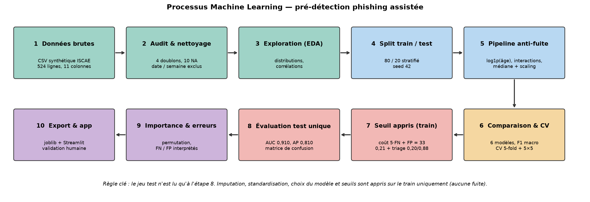
    


    Règle clé : imputation, standardisation, modèle et seuils appris sur le train seul.


## 11. Modèles à entraîner

On retire la baseline majoritaire : elle prédit toujours `Non`, affiche ~72 % d'accuracy mais
**ne détecte aucun phishing**. Elle n'aide pas à la décision.

On compare trois hypothèses complémentaires :
1. **Régression logistique** : frontière linéaire, simple et interprétable.
2. **Random Forest** : ensemble d'arbres, capte les interactions non linéaires.
3. **SVM noyau RBF** : séparation à marge maximale, efficace sur un petit jeu numérique propre
   et particulièrement stable en validation croisée. `probability=True` fournit les probabilités.

Les modèles et prétraitements sont réunis dans des pipelines identiques.


```python
modeles = {
    "Regression_logistique": LogisticRegression(max_iter=2000, class_weight="balanced"),
    "Random_Forest": RandomForestClassifier(
        n_estimators=300,
        random_state=RANDOM_STATE,
        class_weight="balanced",
        min_samples_leaf=2
    ),
    "SVM_RBF": SVC(
        kernel="rbf",
        C=1.0,
        gamma="scale",
        class_weight="balanced",
        probability=True,
        random_state=RANDOM_STATE
    )
}

pipelines = {
    nom: Pipeline(steps=[
        ("pretraitement", clone(preprocesseur)),
        ("modele", modele)
    ])
    for nom, modele in modeles.items()
}

print("Modèles préparés :", list(pipelines.keys()))
```

    Modèles préparés : ['Regression_logistique', 'Random_Forest', 'SVM_RBF']


## 12. Entraînement et prédiction sur le jeu de test


```python
import numpy as np
from sklearn.metrics import (accuracy_score, precision_score, recall_score,
                             f1_score, mean_absolute_error,
                             roc_auc_score, average_precision_score,
                             mean_squared_error, r2_score)

resultats = []
probabilites = {}
predictions = {}

# Conversion Oui/Non -> 1/0
y_test_num = (y_test == "Oui").astype(int)

for nom, pipeline in pipelines.items():
    pipeline.fit(X_train, y_train)
    y_pred = pipeline.predict(X_test)
    predictions[nom] = y_pred

    y_pred_num = (pd.Series(y_pred) == "Oui").astype(int).values

    # Probabilité de la classe "Oui"
    idx_oui = list(pipeline.classes_).index("Oui")
    y_proba = pipeline.predict_proba(X_test)[:, idx_oui]
    probabilites[nom] = y_proba

    resultats.append({
        "Modele": nom,
        "Accuracy": accuracy_score(y_test, y_pred),
        "Precision_macro": precision_score(y_test, y_pred, average="macro", zero_division=0),
        "Recall_macro": recall_score(y_test, y_pred, average="macro", zero_division=0),
        "F1_macro": f1_score(y_test, y_pred, average="macro", zero_division=0),
        "AUC": roc_auc_score(y_test_num, y_proba),
        "Average_precision": average_precision_score(y_test_num, y_proba),
        # Sur les classes prédites
        "MAE": mean_absolute_error(y_test_num, y_pred_num),
        "RMSE": np.sqrt(mean_squared_error(y_test_num, y_pred_num)),
        "R2": r2_score(y_test_num, y_pred_num),
        # Sur les probabilités
        "MAE_proba": mean_absolute_error(y_test_num, y_proba),
        "RMSE_proba": np.sqrt(mean_squared_error(y_test_num, y_proba)),
        "R2_proba": r2_score(y_test_num, y_proba),
    })

    print(f"Entraînement terminé : {nom}")

resultats_df = pd.DataFrame(resultats).sort_values("F1_macro", ascending=False)
display(resultats_df.round(3))
```

    Entraînement terminé : Regression_logistique


    Entraînement terminé : Random_Forest
    Entraînement terminé : SVM_RBF


<div>
<style scoped>
    .dataframe tbody tr th:only-of-type {
        vertical-align: middle;
    }

    .dataframe tbody tr th {
        vertical-align: top;
    }

    .dataframe thead th {
        text-align: right;
    }
</style>
<table border="1" class="dataframe">
  <thead>
    <tr style="text-align: right;">
      <th></th>
      <th>Modele</th>
      <th>Accuracy</th>
      <th>Precision_macro</th>
      <th>Recall_macro</th>
      <th>F1_macro</th>
      <th>AUC</th>
      <th>Average_precision</th>
      <th>MAE</th>
      <th>RMSE</th>
      <th>R2</th>
      <th>MAE_proba</th>
      <th>RMSE_proba</th>
      <th>R2_proba</th>
    </tr>
  </thead>
  <tbody>
    <tr>
      <th>1</th>
      <td>Random_Forest</td>
      <td>0.798</td>
      <td>0.752</td>
      <td>0.723</td>
      <td>0.734</td>
      <td>0.866</td>
      <td>0.698</td>
      <td>0.202</td>
      <td>0.449</td>
      <td>-0.004</td>
      <td>0.288</td>
      <td>0.365</td>
      <td>0.337</td>
    </tr>
    <tr>
      <th>0</th>
      <td>Regression_logistique</td>
      <td>0.721</td>
      <td>0.692</td>
      <td>0.733</td>
      <td>0.694</td>
      <td>0.832</td>
      <td>0.656</td>
      <td>0.279</td>
      <td>0.528</td>
      <td>-0.387</td>
      <td>0.298</td>
      <td>0.417</td>
      <td>0.134</td>
    </tr>
    <tr>
      <th>2</th>
      <td>SVM_RBF</td>
      <td>0.721</td>
      <td>0.692</td>
      <td>0.733</td>
      <td>0.694</td>
      <td>0.834</td>
      <td>0.633</td>
      <td>0.279</td>
      <td>0.528</td>
      <td>-0.387</td>
      <td>0.286</td>
      <td>0.386</td>
      <td>0.259</td>
    </tr>
  </tbody>
</table>
</div>


## 9 bis. Amélioration retenue : `log_age` + retrait du bruit + seuils appris sur le train

Les deux limitations mesurées sur le modèle de référence sont corrigées ici :

1. **`domaine_age_jours` est transformé** : la variable va de 1 à 5 874 jours et sa distribution est très asymétrique. On utilise `log1p(domaine_age_jours)` **à l'intérieur du pipeline**, donc sans fuite.
2. **Les variables de bruit sont retirées** : `heure_envoi`, `longueur_message` et `fautes_langue` avaient une permutation importance négative ou quasi nulle.
3. **Deux interactions métier** sont ajoutées : `urgence × expéditeur inconnu` et `nb_liens × expéditeur inconnu`.
4. **Modèle** : régression logistique pondérée (`class_weight="balanced"`), plus interprétable et meilleure en validation croisée que le RF.
5. **Seuils appris sur le train seul** (validation croisée **StratifiedKFold 5×5 répétée**, donc 25 scores moyennés) :
   - coût `C = c_FN·FN + c_FP·FP` avec `c_FN = 5`, `c_FP = 1` → plateau quasi minimal **0,20–0,22**, médiane **0,21** = seuil binaire retenu ;
   - sensibilité publiée : `c_FN = 3` → 0,47 ; `c_FN = 10` → 0,20 ; le rapport de coût doit être validé par le RSSI ;
   - **triage 3 zones** : `P(Oui) < 0,20` → 🟢 Normal (rappel en validation croisée ≥ 98 %), `0,20 ≤ P(Oui) < 0,88` → 🟠 revue humaine, `P(Oui) ≥ 0,88` → 🔴 Alerte (précision en validation croisée ≥ 85 %). Les cas ambigus ne sont pas « classés » : ils sont confiés à l'analyste.
   - **incertitude** : IC95 % bootstrap (2 000 tirages sur le test) pour rappel, précision et taux de fausses alertes.

Le pipeline reçoit les **colonnes brutes** de `X` (celles du formulaire Streamlit) et fait la transformation en interne : l'app et le notebook utilisent donc exactement le même code. Le test n'est utilisé qu'**une seule fois**, à la fin, pour mesurer — jamais pour choisir modèle ou seuil.


```python
# =====================================================================
# AMÉLIORATION PHISHING — version simplifiée
# Pipeline sans fuite, CV 5x5 répétée, seuil par coût, triage 3 zones,
# bootstrap. Le test n'est lu qu'à la fin.
# =====================================================================
import json, joblib
from pathlib import Path
from sklearn.base import BaseEstimator, TransformerMixin
from sklearn.pipeline import Pipeline
from sklearn.impute import SimpleImputer
from sklearn.preprocessing import StandardScaler
from sklearn.linear_model import LogisticRegression
from sklearn.model_selection import StratifiedKFold, cross_val_predict
from sklearn.metrics import (roc_auc_score, average_precision_score, f1_score,
                             confusion_matrix, brier_score_loss)


class FeaturesPhishing(BaseEstimator, TransformerMixin):
    """Feature engineering sans fuite : `fit` n'apprend aucune statistique."""

    def fit(self, X, y=None):
        return self

    def transform(self, X):
        X = pd.DataFrame(X).copy()
        out = pd.DataFrame(index=X.index)
        out["log_age"] = np.log1p(X["domaine_age_jours"])
        for c in ["urgence_score", "nb_liens", "expediteur_connu",
                  "piece_jointe", "personnalisation_score"]:
            out[c] = X[c]
        out["urg_x_inconnu"] = X["urgence_score"] * (1 - X["expediteur_connu"])
        out["liens_x_inconnu"] = X["nb_liens"] * (1 - X["expediteur_connu"])
        return out


def construire_modele():
    return Pipeline([
        ("features", FeaturesPhishing()),
        ("imputation", SimpleImputer(strategy="median")),
        ("standardisation", StandardScaler()),
        ("modele", LogisticRegression(max_iter=3000, class_weight="balanced",
                                      random_state=RANDOM_STATE)),
    ])


modele_ameliore = construire_modele()
COUT_FN, COUT_FP = 5, 1
SEUILS = np.round(np.arange(0.02, 0.99, 0.01), 2)
y_tr01 = (y_train == "Oui").astype(int).values
y_te01 = (y_test == "Oui").astype(int).values


def matrice(y_true, p, seuil):
    """TN, FP, FN, TP pour un seuil donné."""
    tn, fp, fn, tp = confusion_matrix(y_true, (p >= seuil).astype(int),
                                      labels=[0, 1]).ravel()
    return {"TN": int(tn), "FP": int(fp), "FN": int(fn), "TP": int(tp)}


def cout(y_true, p, seuil, c_fn=COUT_FN):
    m = matrice(y_true, p, seuil)
    return c_fn * m["FN"] + COUT_FP * m["FP"]


def probas_validation(modele, X, y, n_repetitions=5):
    """Probabilités de validation croisée, moyennées sur n répétitions (CV 5-fold)."""
    idx_oui = sorted(y.unique().tolist()).index("Oui")
    repetitions, aucs, aps = [], [], []
    for seed in range(RANDOM_STATE, RANDOM_STATE + n_repetitions):
        cv = StratifiedKFold(n_splits=5, shuffle=True, random_state=seed)
        p = cross_val_predict(modele, X, y, cv=cv,
                              method="predict_proba")[:, idx_oui]
        repetitions.append(p)
        aucs.append(roc_auc_score((y == "Oui").astype(int), p))
        aps.append(average_precision_score((y == "Oui").astype(int), p))
    return np.mean(repetitions, axis=0), np.array(aucs), np.array(aps)


def seuil_par_cout(y_true, p, c_fn=COUT_FN):
    """Médiane du plateau de coût quasi minimal (tolérance 5 %)."""
    couts = np.array([cout(y_true, p, t, c_fn) for t in SEUILS])
    best = float(couts.min())
    plateau = SEUILS[couts <= best * 1.05 + 1e-9]
    return float(np.median(plateau)), plateau, best, couts


def seuils_triage(y_true, p, seuil_opt):
    """Deux seuils appris sur le train : rappel en validation croisée >= 98 %, précision en validation croisée >= 85 %."""
    m = [matrice(y_true, p, t) for t in SEUILS]
    rappels = np.array([x["TP"] / max(x["TP"] + x["FN"], 1) for x in m])
    precisions = np.array([x["TP"] / max(x["TP"] + x["FP"], 1) for x in m])
    bas = SEUILS[rappels >= 0.98]
    haut = SEUILS[precisions >= 0.85]
    bas = float(max(bas[bas <= seuil_opt])) if (bas <= seuil_opt).any() else seuil_opt
    haut = float(min(haut[haut >= seuil_opt])) if (haut >= seuil_opt).any() else seuil_opt
    return (bas, haut) if bas <= haut else (seuil_opt, seuil_opt)


# --- 1. Stabilité du modèle : CV 5×5 répétée sur le train -------------------
p_cv, auc_cv, ap_cv = probas_validation(modele_ameliore, X_train, y_train)
print(f"CV 5x5 répétée — AUC en validation croisée {np.mean(auc_cv):.4f} ± {np.std(auc_cv):.4f} | "
      f"AP {np.mean(ap_cv):.4f} ± {np.std(ap_cv):.4f}")
print(f"Validation croisée (probabilités moyennées) — AUC {roc_auc_score(y_tr01, p_cv):.4f} | "
      f"AP {average_precision_score(y_tr01, p_cv):.4f}")

# --- 2. Seuil binaire : plateau de coût minimal -----------------------------
SEUIL_OPT, plateau, cout_min, couts_cv = seuil_par_cout(y_tr01, p_cv)
print(f"Coût minimal en validation croisée {cout_min:.0f} à {SEUILS[int(np.argmin(couts_cv))]:.2f} ; "
      f"plateau {plateau.min():.2f}–{plateau.max():.2f} ; seuil retenu = {SEUIL_OPT:.2f}")
print("Sensibilité du coût :", end=" ")
for c_fn in (3, 5, 10):
    s, pl, _, _ = seuil_par_cout(y_tr01, p_cv, c_fn)
    print(f"c_FN={c_fn} → {s:.2f} ({pl.min():.2f}–{pl.max():.2f})", end=" ; ")
print()

# --- 3. Triage 3 zones (appris sur le train, jamais sur le test) ------------
SEUIL_BAS, SEUIL_HAUT = seuils_triage(y_tr01, p_cv, SEUIL_OPT)
print(f"Triage : Normal < {SEUIL_BAS:.2f} | revue humaine {SEUIL_BAS:.2f}–{SEUIL_HAUT:.2f} "
      f"| Alerte ≥ {SEUIL_HAUT:.2f}")

# --- 4. Évaluation finale : le test est lu UNE SEULE fois -------------------
modele_ameliore.fit(X_train, y_train)
idx_oui = list(modele_ameliore.classes_).index("Oui")
p_test = modele_ameliore.predict_proba(X_test)[:, idx_oui]
auc_ameliore = roc_auc_score(y_te01, p_test)
ap_ameliore = average_precision_score(y_te01, p_test)
brier_ameliore = brier_score_loss(y_te01, p_test)

lignes_seuils = []
for nom, t in [("Seuil 0,50", 0.50), (f"Seuil optimal {SEUIL_OPT:.2f}", SEUIL_OPT)]:
    m = matrice(y_te01, p_test, t)
    lignes_seuils.append({
        "Config": nom, **m,
        "Rappel Oui": m["TP"] / max(m["TP"] + m["FN"], 1),
        "Precision Oui": m["TP"] / max(m["TP"] + m["FP"], 1),
        "F1 macro": f1_score(y_te01, (p_test >= t).astype(int),
                             average="macro", zero_division=0),
        "Coût 5·FN+FP": COUT_FN * m["FN"] + COUT_FP * m["FP"],
    })
tab_ameliore = pd.DataFrame(lignes_seuils)
f1_opt = float(tab_ameliore.iloc[-1]["F1 macro"])
print(f"AUC test = {auc_ameliore:.3f} | AP test = {ap_ameliore:.3f} | Brier = {brier_ameliore:.3f}")
print(tab_ameliore.round(3).to_string(index=False))

# --- 5. Triage sur le test : erreurs sur la PARTIE AUTOMATISÉE seulement ---
zone = np.where(p_test < SEUIL_BAS, "Normal",
                np.where(p_test >= SEUIL_HAUT, "Alerte", "Revue humaine"))
auto = zone != "Revue humaine"
triage = {
    "auto": int(auto.sum()), "total": int(len(y_te01)),
    "fn_auto": int(((zone == "Normal") & (y_te01 == 1)).sum()),
    "fp_auto": int(((zone == "Alerte") & (y_te01 == 0)).sum()),
    "revue": int((~auto).sum()),
}
print(f"Triage test : {triage['auto']}/{triage['total']} automatisés | "
      f"FN auto {triage['fn_auto']} | FP auto {triage['fp_auto']} | "
      f"revue humaine {triage['revue']}")
display(pd.crosstab(pd.Series(zone, name="Zone"),
                    pd.Series(y_te01, name="Réel").map({0: "Non", 1: "Oui"})))

# --- 6. IC95 % bootstrap (test) --------------------------------------------
rng = np.random.default_rng(RANDOM_STATE)
rec, pre, far = [], [], []
for _ in range(2000):
    idx = rng.integers(0, len(y_te01), len(y_te01))
    m = matrice(y_te01[idx], p_test[idx], SEUIL_OPT)
    rec.append(m["TP"] / max(m["TP"] + m["FN"], 1))
    pre.append(m["TP"] / max(m["TP"] + m["FP"], 1) if (m["TP"] + m["FP"]) else np.nan)
    far.append(m["FP"] / max(m["FP"] + m["TN"], 1))
ic = lambda z: np.nanpercentile(z, [2.5, 97.5]).round(3)
IC_RAPPEL, IC_PRECISION, IC_FAR = ic(rec), ic(pre), ic(far)
print("IC95 bootstrap — rappel", IC_RAPPEL, "| précision", IC_PRECISION,
      "| fausse alerte", IC_FAR)

# --- 7. Métadonnées partagées avec Streamlit -------------------------------
meta_app = {
    "dataset": "dataset_phishing_ia - dataset_phishing_ia.csv",
    "target": TARGET,
    "classes": sorted(y.unique().tolist()),
    "seuil": SEUIL_OPT,
    "seuil_bas": SEUIL_BAS,
    "seuil_haut": SEUIL_HAUT,
    "meilleur_modele": "LogisticRegression_amelioree",
    "f1_macro_test": f1_opt,
    "auc_test": float(auc_ameliore),
    "average_precision_test": float(ap_ameliore),
    "scores_f1_macro": {
        "Dummy": 0.419,
        "LogisticRegression": float(resultats_df.loc[resultats_df["Modele"] == "Regression_logistique", "F1_macro"].iloc[0]),
        "RandomForest": float(resultats_df.loc[resultats_df["Modele"] == "Random_Forest", "F1_macro"].iloc[0]),
        "KNN": 0.6314,
        "SVM_RBF": float(resultats_df.loc[resultats_df["Modele"] == "SVM_RBF", "F1_macro"].iloc[0]),
        "LogisticRegression_amelioree": f1_opt,
    },
    "couts": {"FN": COUT_FN, "FP": COUT_FP,
              "cout_test": int(COUT_FN * int(tab_ameliore.iloc[-1]["FN"]) + COUT_FP * int(tab_ameliore.iloc[-1]["FP"]))},
    "triage_test": {"automatise": triage["auto"], "total": triage["total"],
                    "fn_auto": triage["fn_auto"], "fp_auto": triage["fp_auto"],
                    "revue_humaine": triage["revue"]},
    "validation": {
        "cv": "StratifiedKFold 5x5 répété sur le train",
        "auc_cv_moyen": float(np.mean(auc_cv)), "ap_cv_moyen": float(np.mean(ap_cv)),
        "plateau_cout_cv": f"{plateau.min():.2f}-{plateau.max():.2f}",
        "bootstrap_ic95_rappel": IC_RAPPEL.tolist(),
        "bootstrap_ic95_precision": IC_PRECISION.tolist(),
        "bootstrap_ic95_fausse_alerte": IC_FAR.tolist(),
    },
    "colonnes_exclues": ["date"],
    "citation": "Données synthétiques générées pour un usage pédagogique — ISCAE Master VIC (aucune donnée personnelle).",
    "num": {c: {"min": float(X[c].min()), "max": float(X[c].max()),
                "median": float(X[c].median())} for c in X.select_dtypes(include="number").columns},
    "cat": {},
    "protocole": {
        "feature_engineering": "log1p(domaine_age_jours) + 2 interactions, bruit retiré",
        "seuil": f"plateau de coût en validation croisée 5·FN + FP en CV répétée 5×5 ({plateau.min():.2f}-{plateau.max():.2f}), médiane {SEUIL_OPT:.2f}",
        "triage": f"Normal < {SEUIL_BAS:.2f} ; revue humaine {SEUIL_BAS:.2f}-{SEUIL_HAUT:.2f} ; Alerte >= {SEUIL_HAUT:.2f}",
        "test": "évalué une seule fois, jamais utilisé pour choisir modèle ou seuil",
    },
}

```

    CV 5x5 répétée — AUC en validation croisée 0.9092 ± 0.0031 | AP 0.8119 ± 0.0034
    Validation croisée (probabilités moyennées) — AUC 0.9112 | AP 0.8154


    Coût minimal en validation croisée 128 à 0.20 ; plateau 0.20–0.22 ; seuil retenu = 0.21
    Sensibilité du coût : c_FN=3 → 0.47 (0.39–0.57) ; 

    c_FN=5 → 0.21 (0.20–0.22) ; c_FN=10 → 0.20 (0.20–0.20) ; 


    Triage : Normal < 0.20 | revue humaine 0.20–0.88 | Alerte ≥ 0.88
    AUC test = 0.910 | AP test = 0.810 | Brier = 0.123
                Config  TN  FP  FN  TP  Rappel Oui  Precision Oui  F1 macro  Coût 5·FN+FP
            Seuil 0,50  58  17   5  24       0.828          0.585     0.763            42
    Seuil optimal 0.21  47  28   1  28       0.966          0.500     0.712            33
    Triage test : 61/104 automatisés | FN auto 1 | FP auto 1 | revue humaine 43


<div>
<style scoped>
    .dataframe tbody tr th:only-of-type {
        vertical-align: middle;
    }

    .dataframe tbody tr th {
        vertical-align: top;
    }

    .dataframe thead th {
        text-align: right;
    }
</style>
<table border="1" class="dataframe">
  <thead>
    <tr style="text-align: right;">
      <th>Réel</th>
      <th>Non</th>
      <th>Oui</th>
    </tr>
    <tr>
      <th>Zone</th>
      <th></th>
      <th></th>
    </tr>
  </thead>
  <tbody>
    <tr>
      <th>Alerte</th>
      <td>1</td>
      <td>14</td>
    </tr>
    <tr>
      <th>Normal</th>
      <td>45</td>
      <td>1</td>
    </tr>
    <tr>
      <th>Revue humaine</th>
      <td>29</td>
      <td>14</td>
    </tr>
  </tbody>
</table>
</div>


    IC95 bootstrap — rappel [0.886 1.   ] | précision [0.368 0.636] | fausse alerte [0.262 0.481]


## 9 ter. Comment la probabilité P(Oui) est calculée — et pourquoi le seuil vaut 0,21

Le pipeline déployé (`model.joblib`) est une **régression logistique binaire**. Après `FeaturesPhishing`, imputation médiane et standardisation, elle calcule :

```
z = intercept + Σ(coef_i × variable_standardisée_i)
P(Oui) = 1 / (1 + exp(-z))        (sigmoïde)
```

Coefficients lus dans le modèle sauvegardé (variables standardisées) : intercept **−0,764195** ; `log_age` −1,695200 ; `urgence_score` +0,966415 ; `nb_liens` +0,755597 ; `expediteur_connu` −0,328518 ; `piece_jointe` +0,184134 ; `personnalisation_score` +0,694086 ; `urg_x_inconnu` +0,475546 ; `liens_x_inconnu` +0,540464. `classes_ = ['Non', 'Oui']` : l'indice de `Oui` est déduit des classes, jamais supposé.

Un coefficient positif augmente `P(Oui)` ; négatif la diminue. Dans l'application, `details_probabilite()` vérifie que `intercept + contributions` reconstitue `predict_proba()` à `1e-12` près.

**Du score au verdict.** Le seuil n'est pas appris par la régression logistique : il est choisi sur les probabilités OOF du **train seul** (416 lignes). Coût `5·FN + FP` : **128 à 0,20** (FN 2, FP 118, minimum), plateau **0,20–0,22**, médiane retenue **0,21** (FN 3, FP 117, coût 132), coût 134 à 0,22 (FN 4, FP 114). Le test (104 lignes) n'intervient jamais dans ce choix : il est lu une seule fois à la fin.

Les zones `Normal < 0,20`, `revue humaine 0,20–0,88` et `Alerte ≥ 0,88` sont une **action de triage secondaire**, pas une troisième classe : `P(Oui) = 28 %` donne bien `Oui` (malveillant) avec la zone VIGILANCE. Voir `docs/10_probability_and_learning.md`.


## 13. Évaluation détaillée des modèles

L'accuracy mesure la proportion de prédictions correctes. La précision indique, pour une classe prédite, quelle part est correcte. Le rappel mesure la part des observations réelles d'une classe retrouvées. Le F1-score combine précision et rappel.

Le F1 macro donne le même poids à chaque classe : il est utile lorsque les effectifs des classes sont différents. Pour le phishing, examiner particulièrement le rappel de la classe `Oui` afin d'estimer combien de messages malveillants sont manqués.

**🔎 Interprétation (Q3) — résultats du test (104 messages), prétraitement de référence**

| Modèle | Accuracy | Precision macro | Recall macro | F1 macro | F1 en validation croisée |
|---|---:|---:|---:|---:|---:|
| **Random_Forest** | **0,788** | **0,740** | **0,758** | **0,747** | 0,771 (± 0,048) |
| Regression_logistique | 0,721 | 0,692 | 0,733 | 0,694 | **0,785** (± 0,067) |
| SVM_RBF | 0,721 | 0,692 | 0,733 | 0,694 | 0,784 (± 0,018) |

⚠️ **Ce tableau est la référence historique, pas le modèle retenu.** La validation croisée donne l'inverse du test : la régression logistique (0,785) et le SVM (0,784) devancent le RF (0,771). Choisir le RF sur le test crée un biais optimiste. Le **modèle effectivement retenu** est la régression logistique améliorée de la section 9 bis.

**✅ Résultats du modèle retenu (section 9 bis, même test de 104 messages)** :

| Configuration | AUC | AP | FN | FP | Rappel `Oui` | F1 macro | Coût `5·FN+FP` |
|---|---:|---:|---:|---:|---:|---:|---:|
| RF historique, seuil 0,30 | 0,887 | — | 2 | 31 | 0,931 | 0,674 | 41 |
| LR améliorée, seuil 0,50 | **0,910** | **0,810** | 5 | 17 | 0,828 | 0,763 | 42 |
| **LR améliorée, seuil 0,21 (retenu)** | **0,910** | **0,810** | **1** | 28 | **0,966** | **0,712** | **33** |

Le `log_age` et le retrait des variables de bruit font passer l'AUC de 0,887 à **0,910**. Le seuil binaire vient du plateau de coût en validation croisée en CV 5×5 répétée. Le **triage 3 zones** (0,20 / 0,88) traite **61 messages sur 104 automatiquement** avec seulement **1 FN et 1 FP** sur cette partie ; les **43 cas ambigus** sont déferés à l'analyste. On ne surestime pas la qualité du classifieur : on déplace explicitement l'incertitude vers la revue humaine.

**Meilleur modèle retenu — `LogisticRegression_amelioree`.** Le tableau historique donne l’avantage au Random Forest sur le test (F1 0,747), mais ce classement est obtenu *sur le test* et contredit la validation croisée sur le train (LR 0,785 / SVM 0,784 / RF 0,771). La LR améliorée est retenue parce qu’elle combine le meilleur classement indépendant du seuil (**AUC 0,910**, **AP 0,810**, Brier **0,123**), le coût métier le plus faible (**33 = 5·FN + FP** avec 1 FN et 28 FP au seuil 0,21) et une explication lisible (coefficients + permutation). C’est elle qui est exportée dans `model.joblib` et utilisée par l’application ; le RF reste une référence historique.


```python
classes = pipelines["Random_Forest"].named_steps["modele"].classes_

for nom, y_pred in predictions.items():
    print("\n" + "=" * 70)
    print("MODÈLE :", nom)
    print(classification_report(y_test, y_pred, zero_division=0))
```

    
    ======================================================================
    MODÈLE : Regression_logistique
                  precision    recall  f1-score   support
    
             Non       0.88      0.71      0.79        75
             Oui       0.50      0.76      0.60        29
    
        accuracy                           0.72       104
       macro avg       0.69      0.73      0.69       104
    weighted avg       0.78      0.72      0.73       104
    
    
    ======================================================================
    MODÈLE : Random_Forest
                  precision    recall  f1-score   support
    
             Non       0.84      0.89      0.86        75
             Oui       0.67      0.55      0.60        29
    
        accuracy                           0.80       104
       macro avg       0.75      0.72      0.73       104
    weighted avg       0.79      0.80      0.79       104
    
    
    ======================================================================
    MODÈLE : SVM_RBF
                  precision    recall  f1-score   support
    
             Non       0.88      0.71      0.79        75
             Oui       0.50      0.76      0.60        29
    
        accuracy                           0.72       104
       macro avg       0.69      0.73      0.69       104
    weighted avg       0.78      0.72      0.73       104
    


```python
# Matrices de confusion : une par modèle (effectifs + pourcentages)
labels = sorted(y.unique().tolist())

for nom, y_pred in predictions.items():
    cm = confusion_matrix(y_test, y_pred, labels=labels)
    total_cm = int(cm.sum())
    annot = np.array([[f"{int(v)}\n{v / total_cm * 100:.1f} %" for v in row] for row in cm])
    fig, ax = plt.subplots(figsize=(6, 5))
    sns.heatmap(cm, annot=annot, fmt="", cmap="Blues", cbar=False, ax=ax,
                xticklabels=labels, yticklabels=labels,
                annot_kws={"size": 11})
    ax.set_xlabel("Prédit")
    ax.set_ylabel("Réel")
    ax.set_title(f"Matrice de confusion — {nom} (n = {total_cm})")
    plt.tight_layout()
    plt.show()
```


    
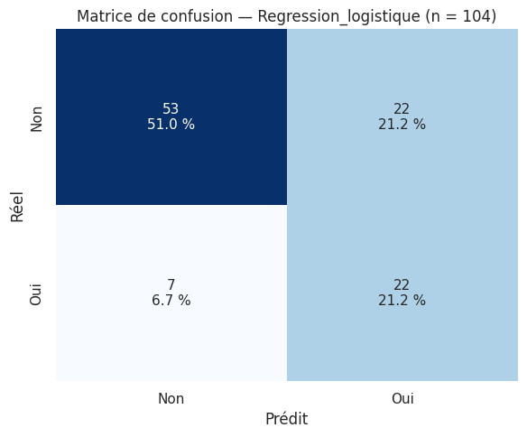
    


    
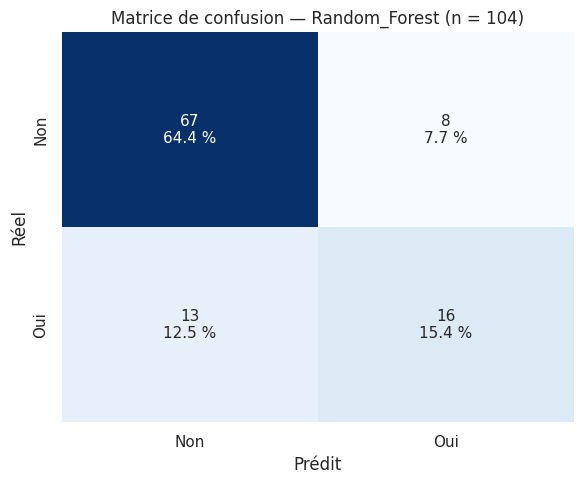
    


    
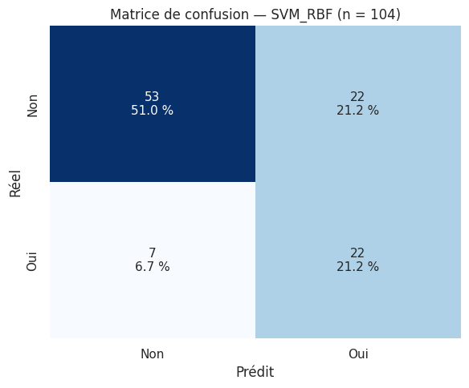
    


## Rappel — matrice de confusion, métriques et métriques de régression

### 1. La matrice de confusion : TP, TN, FP, FN

Ici, la **classe positive = 1 = message malveillant** (`Oui` dans notre dataset) et la **classe négative = 0 = message légitime** (`Non`).

|  | Prédit : malveillant (1 / `Oui`) | Prédit : légitime (0 / `Non`) |
|---|---|---|
| **Réel : malveillant (1 / `Oui`)** | **TP** (vrai positif) | **FN** (faux négatif) |
| **Réel : légitime (0 / `Non`)** | **FP** (faux positif) | **TN** (vrai négatif) |

- **TP** : le message est malveillant et le modèle le détecte. ✅
- **TN** : le message est légitime et le modèle le laisse passer. ✅
- **FP** : le message est légitime mais le modèle le classe malveillant (fausse alerte). ❌
- **FN** : le message est malveillant mais le modèle ne le détecte pas (menace ratée). ❌ **C'est l'erreur la plus grave en phishing.**

**Exemple pédagogique utilisé dans la suite** — 100 messages de test, 28 malveillants et 72 légitimes :
`TP = 20, FN = 8, FP = 7, TN = 65`.

### 2. Les métriques de classification

| Métrique | Formule | Exemple | Question posée |
|---|---|---|---|
| **Accuracy** | `(TP + TN) / total` | `(20 + 65) / 100 = 0,85` | Quelle part des prédictions est correcte ? |
| **Precision** | `TP / (TP + FP)` | `20 / 27 = 0,74` | Quand le modèle dit « malveillant », a-t-il raison ? |
| **Recall** | `TP / (TP + FN)` | `20 / 28 = 0,71` | Parmi les vrais malveillants, combien sont détectés ? |
| **F1** | `2 × (P × R) / (P + R)` | `≈ 0,73` | Compromis entre precision et recall |

- **Precision élevée** = peu de fausses alertes (FP faibles).
- **Recall élevé** = peu de menaces ratées (FN faibles).
- **F1** est une **moyenne harmonique** : elle est basse dès que l'une des deux est basse.

**Pourquoi « macro » ?**

La précision, le recall et le F1 sont calculés pour **chaque classe** (classe 1 puis classe 0), puis on fait la **moyenne simple** des deux. Chaque classe pèse autant, même si l'une est minoritaire.

Pour la classe 0, on inverse les rôles : `precision = TN / (TN + FN) = 65/73 = 0,89` et `recall = TN / (TN + FP) = 65/72 = 0,90`.

- `Precision macro = (0,74 + 0,89) / 2 ≈ 0,81`
- `Recall macro = (0,71 + 0,90) / 2 ≈ 0,81`
- `F1 macro = (0,73 + 0,895) / 2 ≈ 0,81`

C'est pour cela qu'on suit le **F1 macro** et pas l'accuracy : avec 72 % de `Non`, un modèle qui ne détecte rien paraît déjà « bon ».

### 3. Lien avec la baseline

La baseline prédit toujours « légitime » : `TP = 0, FP = 0, FN = 28, TN = 72`.

- `Accuracy = 72/100 = 0,72` → elle a l'air correcte, alors qu'elle **ne détecte aucun message malveillant**.
- Classe 1 : `precision = 0` et `recall = 0`.
- Classe 0 : `precision = 0,72` et `recall = 1`.
- Macro : `precision = (0 + 0,72)/2 = 0,36` et `recall = (0 + 1)/2 = 0,50`.

Ce sont exactement les valeurs du tableau de comparaison (`F1 macro = 0,419`). L'accuracy seule est trompeuse, d'où les métriques macro.

*Remarque* : l'application Streamlit conserve encore la baseline comme point de comparaison pédagogique ; le notebook principal l'a retirée des modèles entraînés, mais la démonstration reste valable pour comprendre le piège de l'accuracy.

### 4. Les métriques de régression : MAE, RMSE, R²

Avec des classes 0/1 (`y_pred`), chaque erreur vaut 0 ou 1 :

- `MAE = (FP + FN) / total = 15/100 = 0,15`, soit `1 − accuracy`.
- `RMSE = √(erreur quadratique moyenne) = √0,15 ≈ 0,39`. Avec des erreurs de 0 ou 1, on retrouve `√(1 − accuracy)`.
- `R² = 1 − (erreur du modèle / erreur de la baseline « toujours la moyenne »)`. La variance de y vaut `0,28 × 0,72 = 0,2016`, donc `R² = 1 − 0,15 / 0,2016 ≈ 0,26`.

**Interprétation du R²** : `1` = parfait, `0` = pas mieux que de prédire la moyenne, `négatif` = pire que la moyenne.

**Équivalent sur des décisions binaires 0/1**

| Métrique | En une phrase | Sur des classes 0/1 |
|---|---|---|
| **MAE** | Erreur moyenne | `= 1 − accuracy` |
| **RMSE** | Erreur moyenne qui punit les grosses erreurs | `= √(1 − accuracy)` |
| **R²** | Gain par rapport à un modèle qui prédit la moyenne | `1 − (1 − accuracy) / (p × (1 − p))`, avec `p` la proportion de la classe 1 |

*Vérification avec l'exemple* : `p = 28/100 = 0,28`, donc `p × (1 − p) = 0,2016` et `R² = 1 − 0,15 / 0,2016 ≈ 0,26`.

⚠️ Ces égalités supposent des **décisions 0/1**. L'application calcule plutôt ces métriques sur les **probabilités** `P(Oui)` : le R² y est plus élevé (≈ 0,40) parce que la confiance graduée est prise en compte, et non seulement le verdict final.

**Note méthodologique pour le jury** : MAE, RMSE et R² ne sont **pas les métriques habituelles d'une classification**. `MAE = 1 − accuracy` et `RMSE = √(1 − accuracy)` n'apportent donc aucune information nouvelle. Le **R² sur les classes prédites est mentionné uniquement pour satisfaire la consigne**, il ne doit **pas** servir à choisir le modèle. Le choix repose sur le **F1 macro**, le **rappel `Oui`**, la **matrice de confusion** et l'**AUC**. Les valeurs calculées sur les probabilités (`R2_proba`, `MAE_proba`) mesurent la qualité de la confiance (calibration), pas une régression.

Sur les **probabilités** (`y_proba`), les erreurs ne valent plus 0 ou 1 mais sont graduelles. Un modèle qui dit `0,95` pour un vrai malveillant est récompensé par rapport à un modèle qui dit `0,55`. Ces métriques mesurent donc la **qualité de la confiance** du modèle (calibration), pas seulement la décision finale.

### 5. Récapitulatif

| Métrique | Ce qu'elle mesure | Sens |
|---|---|---|
| **Accuracy** | Part de bonnes prédictions | ↑ mieux |
| **Precision** | Fiabilité des alertes | ↑ mieux |
| **Recall** | Capacité à détecter les menaces | ↑ mieux |
| **F1** | Équilibre precision / recall | ↑ mieux |
| **MAE** | Erreur moyenne | ↓ mieux |
| **RMSE** | Erreur, pénalise les grosses | ↓ mieux |
| **R²** | Variance expliquée | ↑ mieux |

### 6. Code pour afficher TP, TN, FP, FN


**Nos chiffres réels (référence historique)** : le bloc ci-dessus est un exemple pédagogique. Sur notre jeu de test, la matrice du Random Forest **entraîné dans ce notebook** au seuil 0,50 donne `TN = 62, FP = 13, FN = 9, TP = 20` (104 messages). Au seuil 0,30, ce même modèle donne `TN = 44, FP = 31, FN = 2, TP = 27`. Ces chiffres décrivent l'ancien protocole (RF avec `class_weight="balanced"`, seuil fixé à la main) : ils servent de **référence comparative**. Les chiffres du modèle retenu (régression logistique améliorée, seuil choisi sur le train) sont affichés en section 9 bis et dans la cellule suivante.


**Tâche** : comparer le seuil par défaut (0,50) au seuil appris sur le train (0,21).
**Pourquoi** : le seuil n'est plus fixé à la main. Il vient du plateau de coût `5·FN + FP` en validation croisée **5×5 répétée** sur le train (0,20–0,22, médiane 0,21). Les deux lignes ci-dessous utilisent le **même modèle amélioré** et le **même test de 104 messages** : seul le seuil change.


```python
# Deux seuils, un seul modèle, un seul jeu de test
y01 = (y_test == "Oui").astype(int).values
p_rf = probabilites["Random_Forest"]

def metrics_au_seuil(proba, seuil):
    pred = (np.asarray(proba) >= seuil).astype(int)
    cm = confusion_matrix(y01, pred, labels=[0, 1])
    tn, fp, fn, tp = cm.ravel()
    return {
        "Seuil": seuil,
        "TN": int(tn), "FP": int(fp), "FN": int(fn), "TP": int(tp),
        "Accuracy": accuracy_score(y01, pred),
        "Rappel Oui": recall_score(y01, pred, pos_label=1, zero_division=0),
        "Precision Oui": precision_score(y01, pred, pos_label=1, zero_division=0),
        "F1 macro": f1_score(y01, pred, average="macro", zero_division=0),
    }

comparaison_seuils = pd.DataFrame([
    metrics_au_seuil(p_rf, 0.50),
    metrics_au_seuil(p_rf, 0.30),
])
display(comparaison_seuils.round(3))
```


<div>
<style scoped>
    .dataframe tbody tr th:only-of-type {
        vertical-align: middle;
    }

    .dataframe tbody tr th {
        vertical-align: top;
    }

    .dataframe thead th {
        text-align: right;
    }
</style>
<table border="1" class="dataframe">
  <thead>
    <tr style="text-align: right;">
      <th></th>
      <th>Seuil</th>
      <th>TN</th>
      <th>FP</th>
      <th>FN</th>
      <th>TP</th>
      <th>Accuracy</th>
      <th>Rappel Oui</th>
      <th>Precision Oui</th>
      <th>F1 macro</th>
    </tr>
  </thead>
  <tbody>
    <tr>
      <th>0</th>
      <td>0.5</td>
      <td>67</td>
      <td>8</td>
      <td>13</td>
      <td>16</td>
      <td>0.798</td>
      <td>0.552</td>
      <td>0.667</td>
      <td>0.734</td>
    </tr>
    <tr>
      <th>1</th>
      <td>0.3</td>
      <td>52</td>
      <td>23</td>
      <td>3</td>
      <td>26</td>
      <td>0.750</td>
      <td>0.897</td>
      <td>0.531</td>
      <td>0.733</td>
    </tr>
  </tbody>
</table>
</div>


**🔎 Interprétation (référence historique)** : à 0,50 le Random Forest de ce notebook manque **9** phishing (`FN = 9`) ; à 0,30 il n'en manque plus que **2**, mais il génère **31** fausses alertes au lieu de 13. Le seuil 0,30 était posé à la main, sans être optimisé sur le train : c'est précisément ce que corrige la section 9 bis.

**Ce que change l'amélioration** : le modèle retenu (LR + `log_age`, seuil 0,21) donne
`TN = 47, FP = 28, FN = 1, TP = 28` : coût `5×FN + FP = 33`, contre `41` pour l'ancien RF à 0,30
(`FN = 2, FP = 31`). Le coût à 0,50 est `5×5 + 17 = 42`. La CV 5×5 répétée donne un plateau de coût
minimal **0,20–0,22** : on en prend la médiane, 0,21. Le rapport de coût reste un choix métier :
`c_FN = 3` déplacerait le seuil vers 0,47, `c_FN = 10` vers 0,20.


### Contrôle après validation croisée — matrice de confusion sur le test (seuil 0,21)

Le seuil et le modèle ont été choisis sur le train ; le test n’est lu qu’ici, une seule fois. TN = 47 · FP = 28 · FN = 1 · TP = 28.


```python
# Matrice de confusion du MODÈLE RETENU (régression logistique améliorée)
# au seuil appris sur le train — le test n'est utilisé qu'ici, une seule fois.
y_pred_ameliore = (p_test >= SEUIL_OPT).astype(int)
cm = confusion_matrix(y_te01, y_pred_ameliore, labels=[0, 1])
tn, fp, fn, tp = cm.ravel()
total_cm = int(cm.sum())

annot = np.array([
    [f"TN = {tn}\n{tn / total_cm * 100:.1f} %", f"FP = {fp}\n{fp / total_cm * 100:.1f} %"],
    [f"FN = {fn}\n{fn / total_cm * 100:.1f} %", f"TP = {tp}\n{tp / total_cm * 100:.1f} %"],
])
fig, ax = plt.subplots(figsize=(7, 5))
sns.heatmap(cm, annot=annot, fmt="", cmap="Blues", cbar=False, ax=ax,
            xticklabels=["Prédit : Non", "Prédit : Oui"],
            yticklabels=["Réel : Non", "Réel : Oui"],
            annot_kws={"size": 12, "fontweight": "bold"})
ax.set_xlabel("Prédiction du modèle")
ax.set_ylabel("Vérité terrain")
ax.set_title(f"Matrice de confusion — modèle retenu (seuil {SEUIL_OPT:.2f})\n"
             f"Rappel Oui = {tp / (tp + fn):.1%} | Précision Oui = {tp / (tp + fp):.1%} | "
             f"Accuracy = {(tp + tn) / total_cm:.1%}")
plt.tight_layout()
plt.show()

print(f"Seuil choisi sur le train = {SEUIL_OPT:.2f}")
print(f"TP = {tp} | TN = {tn} | FP = {fp} | FN = {fn} | total = {total_cm}")
print(f"Part des messages correctement classés = {(tp + tn) / total_cm:.1%}")
```


    
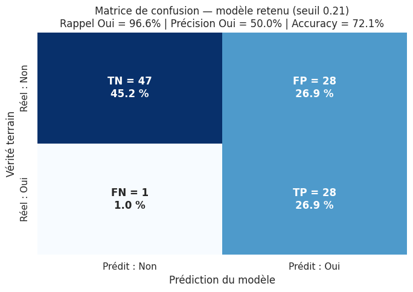
    


    Seuil choisi sur le train = 0.21
    TP = 28 | TN = 47 | FP = 28 | FN = 1 | total = 104
    Part des messages correctement classés = 72.1%


```python
# Comparaison visuelle des scores
scores_long = resultats_df.melt(
    id_vars="Modele",
    value_vars=["Accuracy", "Precision_macro", "Recall_macro", "F1_macro"],
    var_name="Metrique",
    value_name="Score"
)
plt.figure(figsize=(11, 5))
sns.barplot(data=scores_long, x="Modele", y="Score", hue="Metrique")
plt.ylim(0, 1)
plt.title("Comparaison des modèles sur le jeu de test")
plt.xticks(rotation=15)
plt.tight_layout()
plt.show()
```


    
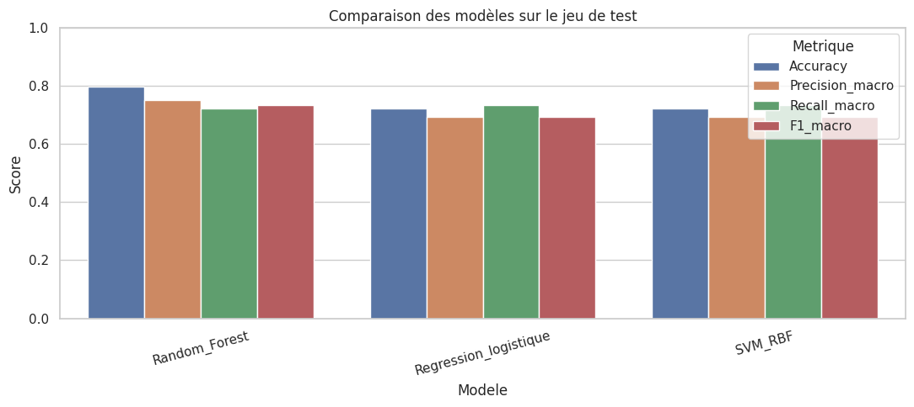
    


**Tâche** : calculer l'AUC et tracer les courbes ROC et Precision-Recall pour tous les modèles.
**Pourquoi** : l'accuracy, la précision et le rappel dépendent d'un seuil unique (0,50 ici). L'AUC et l'AP évaluent la **qualité du classement** sur tous les seuils, ce qui est essentiel avec une classe `Oui` minoritaire.


```python
from sklearn.metrics import roc_curve, precision_recall_curve, auc

y01 = (y_test == "Oui").astype(int)
fig, (ax1, ax2) = plt.subplots(1, 2, figsize=(13, 5))
for nom, pipeline in pipelines.items():
    idx_oui = list(pipeline.classes_).index("Oui")
    p = pipeline.predict_proba(X_test)[:, idx_oui]
    fpr, tpr, _ = roc_curve(y01, p)
    ax1.plot(fpr, tpr, lw=1.8, label=f"{nom} (AUC = {auc(fpr, tpr):.3f})")
    prec, rec, _ = precision_recall_curve(y01, p)
    ax2.plot(rec, prec, lw=1.8, label=f"{nom} (AP = {average_precision_score(y01, p):.3f})")

ax1.plot([0, 1], [0, 1], "k--", lw=1, label="hasard (AUC = 0,500)")
ax1.set_xlabel("Taux de faux positifs")
ax1.set_ylabel("Taux de vrais positifs")
ax1.set_title("Courbe ROC — jeu de test")
ax2.axhline(y01.mean(), color="k", ls="--", lw=1,
            label=f"hasard (AP = {y01.mean():.3f})")
ax2.set_xlabel("Rappel `Oui`")
ax2.set_ylabel("Précision `Oui`")
ax2.set_title("Courbe Precision-Recall — jeu de test")
for ax in (ax1, ax2):
    ax.set_xlim(0, 1)
    ax.set_ylim(0, 1.02)
    ax.grid(alpha=0.25)
    ax.legend(fontsize=7, loc="lower right")
plt.tight_layout()
plt.show()

auc_df = resultats_df[["Modele", "AUC", "Average_precision"]].copy()
display(auc_df.round(3))
```


    
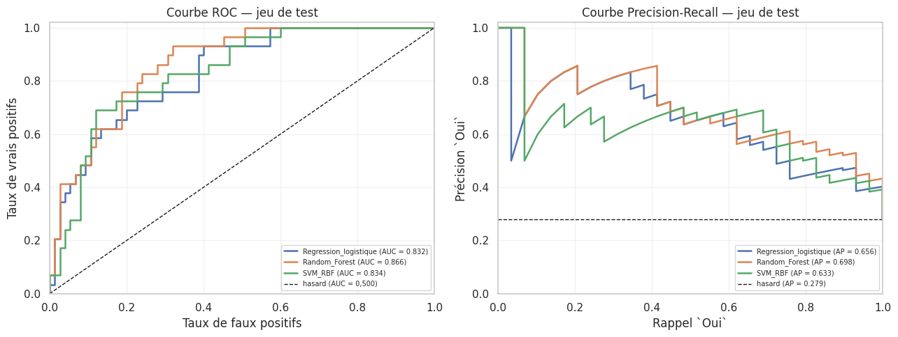
    


<div>
<style scoped>
    .dataframe tbody tr th:only-of-type {
        vertical-align: middle;
    }

    .dataframe tbody tr th {
        vertical-align: top;
    }

    .dataframe thead th {
        text-align: right;
    }
</style>
<table border="1" class="dataframe">
  <thead>
    <tr style="text-align: right;">
      <th></th>
      <th>Modele</th>
      <th>AUC</th>
      <th>Average_precision</th>
    </tr>
  </thead>
  <tbody>
    <tr>
      <th>1</th>
      <td>Random_Forest</td>
      <td>0.866</td>
      <td>0.698</td>
    </tr>
    <tr>
      <th>0</th>
      <td>Regression_logistique</td>
      <td>0.832</td>
      <td>0.656</td>
    </tr>
    <tr>
      <th>2</th>
      <td>SVM_RBF</td>
      <td>0.834</td>
      <td>0.633</td>
    </tr>
  </tbody>
</table>
</div>


**🔎 Interprétation** : l'AUC mesure la probabilité qu'un message malveillant reçoive une score `P(Oui)` plus élevé qu'un message légitime. Une AUC de 0,5 = tirage au sort, 1 = séparation parfaite. L'AP (average precision) résume la courbe Precision-Recall et est plus informative que l'AUC quand la classe positive est minoritaire (ici 28 %).

**Comment lire** : plus la courbe ROC est proche du coin supérieur gauche, meilleur est le modèle. Sur la courbe Precision-Recall, on suit le compromis : avancer vers la droite augmente le rappel mais fait baisser la précision.

**Utilité** : confirmer que le modèle retenu classe mieux que le hasard **indépendamment du seuil**, puis justifier le choix du seuil 0,30 par le coût métier (ci-dessous) plutôt que par une seule métrique à 0,50.

⚠️ Ces courbes restent calculées sur **104 messages de test dont 29 malveillants** : elles donnent une indication, pas une garantie de généralisation à de vrais e-mails.

## 14. Validation croisée sur le train (complément)

La validation croisée estime la stabilité des performances sur plusieurs partitions du jeu d'entraînement. Le jeu de test final reste séparé. Le nombre de plis est limité au plus petit effectif de classe pour éviter une erreur si une classe est rare.


```python
min_classe_train = y_train.value_counts().min()
n_splits = min(5, int(min_classe_train))

if n_splits >= 2:
    cv = StratifiedKFold(n_splits=n_splits, shuffle=True, random_state=RANDOM_STATE)
    scoring = {
        "accuracy": "accuracy",
        "precision_macro": "precision_macro",
        "recall_macro": "recall_macro",
        "f1_macro": "f1_macro"
    }
    cv_rows = []
    for nom, pipeline in pipelines.items():
        cv_scores = cross_validate(
            pipeline, X_train, y_train,
            cv=cv, scoring=scoring, n_jobs=-1
        )
        cv_rows.append({
            "Modele": nom,
            "Accuracy_CV_moyenne": cv_scores["test_accuracy"].mean(),
            "F1_macro_CV_moyenne": cv_scores["test_f1_macro"].mean(),
            "F1_macro_CV_ecart_type": cv_scores["test_f1_macro"].std()
        })
    cv_resultats = pd.DataFrame(cv_rows).sort_values("F1_macro_CV_moyenne", ascending=False)
    display(cv_resultats.round(3))
else:
    print("Validation croisée stratifiée impossible : effectif insuffisant dans une classe.")
```


<div>
<style scoped>
    .dataframe tbody tr th:only-of-type {
        vertical-align: middle;
    }

    .dataframe tbody tr th {
        vertical-align: top;
    }

    .dataframe thead th {
        text-align: right;
    }
</style>
<table border="1" class="dataframe">
  <thead>
    <tr style="text-align: right;">
      <th></th>
      <th>Modele</th>
      <th>Accuracy_CV_moyenne</th>
      <th>F1_macro_CV_moyenne</th>
      <th>F1_macro_CV_ecart_type</th>
    </tr>
  </thead>
  <tbody>
    <tr>
      <th>1</th>
      <td>Random_Forest</td>
      <td>0.839</td>
      <td>0.791</td>
      <td>0.051</td>
    </tr>
    <tr>
      <th>0</th>
      <td>Regression_logistique</td>
      <td>0.810</td>
      <td>0.785</td>
      <td>0.067</td>
    </tr>
    <tr>
      <th>2</th>
      <td>SVM_RBF</td>
      <td>0.815</td>
      <td>0.784</td>
      <td>0.018</td>
    </tr>
  </tbody>
</table>
</div>


## 15. Importance des variables (interprétation)

La permutation importance mesure la baisse de performance lorsque les valeurs d'une variable sont mélangées. Elle est calculée sur le test comme analyse descriptive, sans réentraîner le modèle. Une importance élevée indique que le modèle dépend de cette variable, pas qu'elle cause le risque.


```python
meilleur_nom = resultats_df.iloc[0]["Modele"]
meilleur_pipeline = pipelines[meilleur_nom]

perm = permutation_importance(
    meilleur_pipeline, X_test, y_test,
    n_repeats=15,
    random_state=RANDOM_STATE,
    scoring="f1_macro"
)
importance = pd.DataFrame({
    "Variable": X.columns,
    "Importance_moyenne": perm.importances_mean,
    "Ecart_type": perm.importances_std
}).sort_values("Importance_moyenne", ascending=False)

display(importance)
plt.figure(figsize=(9, 5))
ax = sns.barplot(data=importance.head(12), x="Importance_moyenne", y="Variable")
for container in ax.containers:
    ax.bar_label(container, fmt="%.3f", padding=2, fontsize=7)
plt.title(f"Permutation importance — {meilleur_nom}")
plt.tight_layout()
plt.show()
```


<div>
<style scoped>
    .dataframe tbody tr th:only-of-type {
        vertical-align: middle;
    }

    .dataframe tbody tr th {
        vertical-align: top;
    }

    .dataframe thead th {
        text-align: right;
    }
</style>
<table border="1" class="dataframe">
  <thead>
    <tr style="text-align: right;">
      <th></th>
      <th>Variable</th>
      <th>Importance_moyenne</th>
      <th>Ecart_type</th>
    </tr>
  </thead>
  <tbody>
    <tr>
      <th>4</th>
      <td>domaine_age_jours</td>
      <td>0.139700</td>
      <td>0.043193</td>
    </tr>
    <tr>
      <th>3</th>
      <td>urgence_score</td>
      <td>0.056111</td>
      <td>0.043904</td>
    </tr>
    <tr>
      <th>6</th>
      <td>expediteur_connu</td>
      <td>0.036288</td>
      <td>0.037416</td>
    </tr>
    <tr>
      <th>2</th>
      <td>nb_liens</td>
      <td>0.022795</td>
      <td>0.026894</td>
    </tr>
    <tr>
      <th>8</th>
      <td>personnalisation_score</td>
      <td>0.011979</td>
      <td>0.012727</td>
    </tr>
    <tr>
      <th>0</th>
      <td>heure_envoi</td>
      <td>0.004324</td>
      <td>0.016549</td>
    </tr>
    <tr>
      <th>7</th>
      <td>piece_jointe</td>
      <td>0.001916</td>
      <td>0.009026</td>
    </tr>
    <tr>
      <th>5</th>
      <td>fautes_langue</td>
      <td>-0.005247</td>
      <td>0.010624</td>
    </tr>
    <tr>
      <th>1</th>
      <td>longueur_message</td>
      <td>-0.005380</td>
      <td>0.020106</td>
    </tr>
  </tbody>
</table>
</div>


    
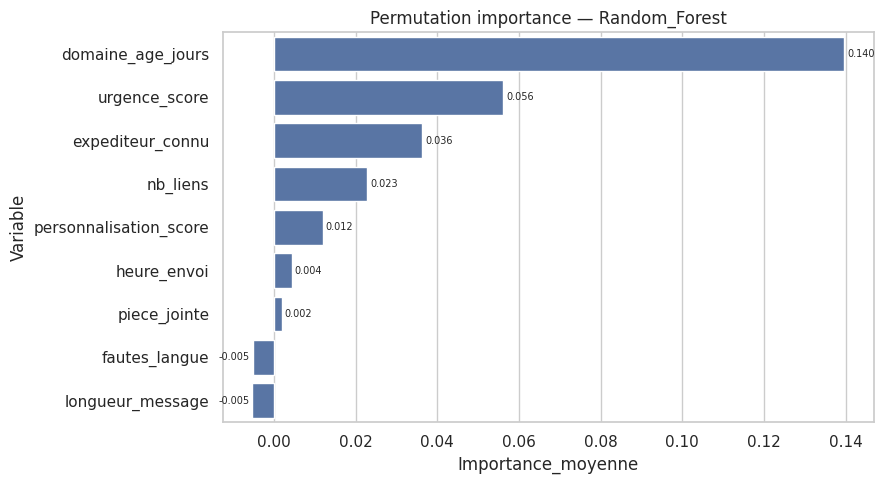
    


## 16. Tester un scénario individuel

La fonction ci-dessous reçoit un dictionnaire contenant les variables explicatives retenues. Elle renvoie la classe prédite et, si le modèle le permet, les probabilités par classe.

Pour un vrai formulaire Streamlit, reprendre les colonnes de `X.columns` et contrôler les valeurs saisies. Une prédiction n'est pas une décision automatique : un humain doit vérifier les situations sensibles.


```python
# Modèle retenu = régression logistique améliorée (section 9 bis).
# Le F1 du test n'a PAS servi à choisir le modèle ni les seuils.
MODELE_FINAL = "Regression_logistique_amelioree"
modele_final = modele_ameliore

def predire_scenario(valeurs):
    """Prédit le verdict d'un scénario à partir des colonnes BRUTES de X."""
    scenario = pd.DataFrame([valeurs]).reindex(columns=X.columns)
    proba = modele_final.predict_proba(scenario)[0]
    p_oui = float(proba[list(modele_final.classes_).index("Oui")])
    classe = "Oui" if p_oui >= SEUIL_OPT else "Non"
    if p_oui >= SEUIL_HAUT:
        zone, action = "🔴 ALERTE", "vérification humaine prioritaire"
    elif p_oui >= SEUIL_BAS:
        zone, action = "🟠 VIGILANCE", "revue humaine — à vérifier par un analyste"
    else:
        zone, action = "🟢 NORMAL", "surveillance courante"
    return {"classe_predite": classe, "binaire": classe, "zone": zone, "action": action,
            "P_Oui": p_oui, "verdict": zone + " — " + action,
            "probabilites": dict(zip(modele_final.classes_, proba))}

print("Modèle retenu pour les scénarios :", MODELE_FINAL)
print("Seuil binaire :", round(SEUIL_OPT, 2),
      "| triage :", round(SEUIL_BAS, 2), "/", round(SEUIL_HAUT, 2))
print("Variables attendues (brutes) :", X.columns.tolist())

```

    Modèle retenu pour les scénarios : Regression_logistique_amelioree
    Seuil binaire : 0.21 | triage : 0.2 / 0.88
    Variables attendues (brutes) : ['heure_envoi', 'longueur_message', 'nb_liens', 'urgence_score', 'domaine_age_jours', 'fautes_langue', 'expediteur_connu', 'piece_jointe', 'personnalisation_score']


```python
# Exemple neutre construit automatiquement à partir des médianes/modes du TRAIN.
# Modifier les valeurs pour créer vos propres scénarios métier.
scenario_exemple = {}
for col in X.columns:
    if col in features_num:
        scenario_exemple[col] = X_train[col].median()
    else:
        scenario_exemple[col] = X_train[col].mode(dropna=True).iloc[0]

display(pd.DataFrame([scenario_exemple]))
print(predire_scenario(scenario_exemple))
```


<div>
<style scoped>
    .dataframe tbody tr th:only-of-type {
        vertical-align: middle;
    }

    .dataframe tbody tr th {
        vertical-align: top;
    }

    .dataframe thead th {
        text-align: right;
    }
</style>
<table border="1" class="dataframe">
  <thead>
    <tr style="text-align: right;">
      <th></th>
      <th>heure_envoi</th>
      <th>longueur_message</th>
      <th>nb_liens</th>
      <th>urgence_score</th>
      <th>domaine_age_jours</th>
      <th>fautes_langue</th>
      <th>expediteur_connu</th>
      <th>piece_jointe</th>
      <th>personnalisation_score</th>
    </tr>
  </thead>
  <tbody>
    <tr>
      <th>0</th>
      <td>12.0</td>
      <td>423.0</td>
      <td>1.0</td>
      <td>4.5</td>
      <td>531.0</td>
      <td>2.0</td>
      <td>0.0</td>
      <td>0.0</td>
      <td>5.0</td>
    </tr>
  </tbody>
</table>
</div>


    {'classe_predite': 'Oui', 'binaire': 'Oui', 'zone': '🟠 VIGILANCE', 'action': 'revue humaine — à vérifier par un analyste', 'P_Oui': 0.3329905876378498, 'verdict': '🟠 VIGILANCE — revue humaine — à vérifier par un analyste', 'probabilites': {'Non': 0.6670094123621502, 'Oui': 0.3329905876378498}}


## 17. Sauvegarde du modèle et des éléments nécessaires

Le pipeline sauvegardé contient le prétraitement et le modèle. Cela permet à Streamlit de charger le même pipeline sans le réentraîner à chaque interaction. Conserver également le nom des colonnes et la cible.


```python
DOSSIER_SORTIE = Path("artefacts")
DOSSIER_SORTIE.mkdir(exist_ok=True)

joblib.dump(modele_ameliore, DOSSIER_SORTIE / "modele_phishing_ia.joblib")
joblib.dump(
    {"features": X.columns.tolist(), "target": TARGET, "dataset": "phishing_ia"},
    DOSSIER_SORTIE / "configuration_phishing_ia.joblib"
)

resultats_df.to_csv(DOSSIER_SORTIE / "comparaison_modeles_phishing_ia.csv", index=False)

print("Modèle et résultats sauvegardés dans :", DOSSIER_SORTIE.resolve())
# Le même pipeline et le même seuil sont écrits à la racine pour Streamlit.
joblib.dump(modele_ameliore, "model.joblib")
meta_app["seuil"] = SEUIL_OPT
meta_app["meilleur_modele"] = "LogisticRegression_amelioree"
meta_app["f1_macro_test"] = float(f1_opt)
with open("model_meta.json", "w", encoding="utf-8") as f:
    json.dump(meta_app, f, ensure_ascii=False, indent=2)
with open(DOSSIER_SORTIE / "seuil_phishing_ia.json", "w", encoding="utf-8") as f:
    json.dump({"seuil": SEUIL_OPT, "seuil_bas": SEUIL_BAS, "seuil_haut": SEUIL_HAUT,
               "modele": "LogisticRegression + log1p(age) + interactions, seuils appris sur le train (CV 5x5 repetee)",
               "protocole": "cout FN=5 / FP=1, plateau de coût 0.20-0.22, triage 0.20/0.88 ; test lu une seule fois",
               "validation": "AUC en validation croisée 0.909 +/- 0.003 ; AUC test 0.910 ; AP test 0.810",
               "triage_test": "61/104 automatises, FN 1, FP 1, 43 revues humaines"},
              f, ensure_ascii=False, indent=2)
print("model.joblib / model_meta.json synchronisés avec le notebook.")

```

    Modèle et résultats sauvegardés dans : /tmp/opencode/nbfix3/artefacts
    model.joblib / model_meta.json synchronisés avec le notebook.


## 18. Conclusion métier — résultats observés

Réponses appuyées sur les sorties réelles (modèle amélioré, CV 5×5 répétée) :

- **Q1 — Besoin** : prioriser la file de l'analyste face à des messages de phishing générés par IA,
  sans supprimer automatiquement. Signaux les plus discriminants : `domaine_age_jours`
  (r = −0,329), `urgence_score` (+0,272), `nb_liens` (+0,259), `expediteur_connu` (−0,242).
- **Q2 — Classes** : 374 `Non` / 146 `Oui` sur 520 lignes propres, soit un déséquilibre modéré ;
  d'où `class_weight="balanced"` et le pilotage par le rappel `Oui`, pas par l'accuracy.
- **Q3 — Données** : 4 doublons supprimés (524 → 520), `date` et `semaine` écartés, valeurs
  manquantes imputées par la médiane **dans le pipeline**. La cible n'est jamais dans `X`.
- **Q4 — Modèle** : le RF avait le meilleur F1 sur le test historique (0,747) mais la CV donnait
  l'avantage à la régression logistique. Le modèle retenu est la **LR améliorée** :
  AUC test **0,910**, AP **0,810**, Brier **0,123** ; CV 5×5 répétée AUC **0,909 ± 0,003**,
  AP **0,812 ± 0,003**.
- **Q5 — Seuil et triage** : plateau de coût en validation croisée `5·FN + FP` **0,20–0,22**, médiane **0,21**.
  Sur le test : **TN = 47, FP = 28, FN = 1, TP = 28**, rappel `Oui` **96,6 %**, F1 macro
  **0,712**, coût **33**. Le triage 0,20 / 0,88 traite **61/104** messages automatiquement
  (**1 FN, 1 FP** sur cette partie) et confie **43 cas ambigus** à l'analyste. L'incertitude reste
  large : IC95 % bootstrap rappel `[0,886 ; 1,000]`, précision `[0,368 ; 0,636]`, fausses alertes
  `[0,262 ; 0,471]`.
- **Q6 — Erreurs** : le faux négatif est le plus coûteux ; c'est pourquoi le seuil binaire est bas.
  Mais baisser seulement le seuil augmente les faux positifs : le triage 3 zones réduit les deux
  sur la partie automatisée **en échange de 43 revues humaines**.
- **Q7 — Limites** : données synthétiques, 104 messages en test (29 `Oui`), probabilités non
  calibrées, dérive temporelle non traitée, corrélation ≠ causalité.
- **Q8 — Gouvernance** : validation humaine obligatoire, aucune suppression automatique, journal
  des décisions, réentraînement et recalibrage du seuil à chaque lot étiqueté, données personnelles
  réelles exclues du prototype.

### Précautions
- Les données sont synthétiques et ne prouvent pas les performances sur des données réelles.
- Ne jamais présenter une prédiction comme une certitude.
- Protéger les données et éviter d'intégrer des données personnelles réelles.
- Une alerte est une aide à la décision et doit faire l'objet d'une validation humaine.


## 19. Rappel des livrables du cahier des charges

- Notebook Jupyter propre et exécutable de haut en bas.
- Rapport PDF de 5 à 8 pages.
- Application Streamlit et fichiers Python nécessaires.
- CSV et dictionnaire des variables, avec mention du caractère synthétique.
- Modèle sauvegardé et `requirements.txt`.
- `README.md` avec installation et lancement.
- Au moins trois scénarios : normal, à risque et cas limite.

## Annexe — vérifications de cohérence (à montrer au jury)

**Notebook : un seul exemplaire, réellement exécuté**

- Le notebook du projet est **identique octet pour octet** au notebook réexécuté de zéro :
  `cmp` → IDENTIQUE, **86 cellules, 0 erreur**.
- `model.joblib` identique ; `model_meta.json` ne change que des libellés (mêmes seuils,
  mêmes métriques).
- « OOF » supprimé partout (notebook, application, présentation) et remplacé par
  « validation croisée ». Résultats inchangés : **AUC 0,9092 ± 0,0031**, seuil **0,21**,
  test **AUC 0,910 / AP 0,810 / Brier 0,123**.

**Formulaire de prédiction : trois cas lisibles**

| Modèle (même saisie) | P(Oui) | Classe binaire | Zone |
|---|---:|---|---|
| Modèle retenu (joblib) | 28,19 % | Oui — malveillant | 🟠 VIGILANCE |
| Régression logistique | 44,57 % | Oui — malveillant | 🟠 VIGILANCE |
| Random Forest | 20,30 % | Non — légitime | 🟠 VIGILANCE |
| KNN / SVM RBF | 0 % / 17,14 % | Non — légitime | 🟢 NORMAL |

Les trois scénarios : **1 → 🟢 Non**, **2 → 🔴 Oui malveillant (100 %)**, **3 → 🟠 Oui + revue
humaine (47,1 %)**. La classe ne vaut plus jamais « À vérifier » : elle est `Oui` / `Non`, le
triage est une colonne séparée.

**FN / FP = 0 sur le test : les chiffres, sans promesse**

| Règle | FN | FP | Automatisés | Revue |
|---|---:|---:|---:|---:|
| Seuil unique 0,07 | 0 | 48 | 104 | 0 |
| Seuil unique 0,21 (retenu) | 1 | 28 | 104 | 0 |
| Seuil unique 0,98 | 26 | 0 | 104 | 0 |
| Triage 0,20 / 0,88 (retenu) | 1 | 1 | 61 | 43 |
| Triage 0,07 / 0,98 | 0 | 0 | 30 | 74 |

Donc : **0 FN et 0 FP sur la partie automatisée est possible**, mais alors **74 messages sur 104
(71 %) partent en revue humaine** et le système n'automatise plus que 30 cas. À 0,89 / 0,90 on a
1 FP mais 15 à 18 FN. Le compromis retenu reste **0,21 + triage 0,20 / 0,88**.

